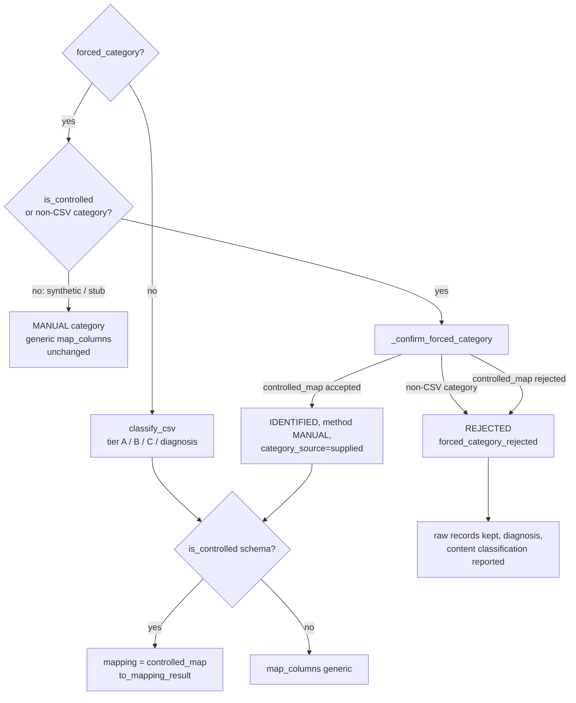

# UC-042 Smart Parser: Phase 3B-0 report

**Closing the forced-category mapping gap. 18 November 2026.**

**Working copy:** `C:\Users\artlptp263user\p10\smartparser_phase1`. The UC-042 tree was used read-only.

**Scope:** Phase 3B-0 only. No LLM, proposal, approval workflow, layouts, field guidance, handoff, value transformation or PDF extraction.

## Summary

Every UC-042 CSV category now has **one mapping authority, the Phase 2 controlled rules**, whatever decided the category: the exact header, controlled mapping, or a category supplied by a caller or reviewer.

**What a supplied category now means:** it is treated as a claim about the evidence type. The header must still pass that category's controlled rules; otherwise the category is **rejected** (`forced_category_rejected`, the file left unresolved, records kept).

**Generic path:** `map_columns` remains untouched for synthetic, provisional and stub schemas.

**Results:**
- 287 tests pass (the 170 existing plus 117 new);
- the Phase 1 baseline is 445/445;
- the Phase 2 corpus is 161/161;
- the registry is in sync;
- no alias is approved;
- no protected file changed.

## 1. Verified original execution paths (before the change)

These paths were traced in `smartparser/pipeline.py::_process_csv` and confirmed by running the code (`evidence/forced_path_before.json`):

| # | Input | Classification | Mapping call | Result before |
|---|---|---|---|---|
| 1 | Canonical CSV, automatic | `classify_csv`, tier A `csv_exact_header` | `map_columns` (tier 1 exact for every column) | complete, valid |
| 2 | Reordered CSV, automatic | `classify_csv`, tier B `csv_controlled_mapping` | `to_mapping_result(controlled mapping)` | complete, valid |
| 3 | Whitespace or case variation, automatic | Tier B | `to_mapping_result` | complete, valid |
| 4 | **Any CSV with `forced_category`** | **Skipped.** `ClassificationResult(IDENTIFIED, method=MANUAL)` was built with no check of the header | **`map_columns(table.headers, schema, templates, manual_mapping)`**: tiers exact, alias, **normalised name**, template | see below |
| 5 | Unknown header plus supplied category | Same as 4 | Same as 4 | see below |
| 6 | Automatically identified UC-042 file plus `manual_mapping` | Tier A or B | **`map_columns(..., manual)`**, a second bypass | manual mapping applied without rules |

**Before-change results (actually executed):**

| Case | Category | Mapping | Validation | Processing |
|---|---|---|---|---|
| IN-09 headers in camelCase (`bankEntryId` …), forced IN-09 | IN-09 | **complete** (methods `exact` and `normalised`) | **valid** | **completed** |
| IN-09 headers hyphenated (`bank-entry-id` …), forced IN-09 | IN-09 | **complete** | **valid** | **completed** |
| IN-09 plus extra column `note`, forced IN-09 | IN-09 | **complete** (`note` only listed as unmapped) | valid | completed |
| IN-09 file forced as IN-10 | **IN-10, `identified`** | incomplete (4 of 8 fields) | — | — |
| IN-08 file forced as IN-07 | **IN-07, `identified`** | incomplete | — | — |
| IN-06 file forced as IN-05 | **IN-05, `identified`** | incomplete | — | — |

Found while inspecting, and not listed in the brief: forcing a **PDF** category (IN-15 to IN-19) onto a CSV reached `map_columns` with a field-less schema, which reports `complete` with zero fields.

## 2. Root cause

Category decision and column mapping were **coupled to the classifier's method**. The pipeline used the controlled mapping only when `cls.method == CSV_CONTROLLED_MAPPING`; every other route fell through to the generic `map_columns`.

A supplied category produced `method = MANUAL`, so it always took the generic route. That route's tier 3 (`normalise_name`) maps camelCase, hyphenated and punctuated names, and its validator treats extra columns as INFO. Three things followed:
- an unapproved layout could become `completed`;
- a wrong supplied category stayed `identified`;
- `manual_mapping` could override UC-042 columns.

## 3. Files changed

| File | Change | Why |
|---|---|---|
| `smartparser/mapping/controlled.py` | New `is_controlled(schema)` routing predicate: a CSV schema with a generated UC-042 CSV contract and `exact_header` matching | One explicit, independently testable routing rule. No duplicated mapping logic. |
| `smartparser/pipeline.py` | (a) Forced category on a UC-042 or non-CSV category goes to `_confirm_forced_category`. (b) Mapping for any `is_controlled` schema comes from `controlled_map` (`map_columns` is never used for those). (c) `manual_mapping` is refused for UC-042 categories (`_refuse_manual_mapping`). (d) A rejected supplied category raises a `forced_category_rejected` error issue. (e) `_rules()` gives the active rules (default or injected). | Closes paths 4, 5 and 6 and the PDF-category case in one place |
| `smartparser/models/enums.py` | `IssueCode.FORCED_CATEGORY_REJECTED` | Distinguishes a rejected supplied category from an ordinary unknown |
| `tests/test_forced_category.py` | New: 14 test functions, 117 parametrised cases | Section 5 |
| `docs/UC042_SMART_PARSER_PHASE3B0_REPORT.md` | This report | |

**Unchanged:**
- `classify/csv_classifier.py`, `mapping/engine.py` (`map_columns`), `mapping/rules/*` and the registry;
- every existing test (none edited);
- PDF handling.

## 4. New routing behaviour



**What does not change for a supplied category:**
- **Classification method:** it stays `manual` and `confidence` stays `None`, because the category was supplied, not inferred.
- **Column-level semantics:** these are the Phase 2 ones: `exact`, `policy_normalised` (variation `whitespace`, `case` or `case+whitespace`) and `alias`, with `original_header`, `source_index` and `alias_id`.
- **Content classification:** what the content alone says is reported in `details.content_classification`. It is **never substituted** for the supplied category. For example: "By content the file identifies as IN-09 …; the supplied category is not replaced automatically".

**Automatic classification:** tier A and B semantics are unchanged (`csv_exact_header` at 1.0, `csv_controlled_mapping` at 0.9). Exact-header files are now mapped by `controlled_map` too. All columns are `exact`, so the result is identical to before; the Phase 1 baseline pipeline counts are unchanged (section 7).

**Example after the change:** the IN-09 file forced as IN-10 gives

```
classification_status = unknown, evidence_category = None, mapping_status = not_attempted
issue forced_category_rejected (error):
  "Supplied category IN-10 rejected: the header does not map under the IN-10 controlled mapping rules:
   unexpected column(s) ['bank_entry_id', 'statement_id', 'booking_date', 'booking_ts', 'value_date', ...];
   missing required column(s) ['ledger_entry_id', 'posted_ts', 'entry_type', 'payment_reference'].
   By content the file identifies as IN-09 (csv_exact_header); the supplied category is not replaced automatically"
records: all 266 source rows kept with original cells and line numbers
```

## 5. Tests added: `tests/test_forced_category.py` (117 cases, all executed)

| Scenario (brief §4) | Test | Result |
|---|---|---|
| Canonical headers | `test_forced_canonical_and_reordered_accepted` (14 categories) | Accepted, all `exact` |
| Reordered | Same (14) | Accepted; records identical to canonical |
| Surrounding whitespace / case | `test_forced_whitespace_and_case_accepted_under_policy` | Accepted; `policy_normalised`; original header kept |
| Approved alias | `test_forced_approved_alias_accepted_with_test_rules` | Accepted with `alias_id` (test-fixture rules only) |
| Proposed-only alias | `…does_not_override_structural_failures[proposed_only_alias-*]` (14) | Rejected |
| camelCase | `[camelCase-*]` (14) plus `test_camelcase_accepted_only_when_explicitly_approved` | Rejected; accepted only with an explicitly approved (test) alias |
| Hyphenated | `[hyphenated-*]` (14) | Rejected |
| Missing field | `[missing_field-*]` (14) | Rejected |
| Extra field | `[extra_field-*]` (14) plus `test_extra_column_is_reported_not_dropped` | Rejected; column reported; cell value kept |
| Duplicate target | `[duplicate_target-*]` (14) | Rejected |
| Ambiguous alias (`Reference`) | `test_forced_ambiguous_alias_rejected` | Rejected |
| Wrong evidence category: IN-09↔IN-10, IN-07↔IN-08, IN-05↔IN-06 (both directions) | `test_wrong_forced_category_rejected_for_confusable_pairs` (6) | Rejected; true category reported, not substituted |
| PDF category forced on a CSV | `test_forcing_a_pdf_category_onto_a_csv_is_rejected` (3) | Rejected |
| Misleading filename | `test_misleading_filename_never_decides` | Filename has no effect |
| `manual_mapping` on UC-042 | `test_manual_mapping_refused_for_uc042_categories` | `ValueError` (forced and automatic) |
| Generic synthetic schema | `test_generic_synthetic_schema_keeps_loose_mapping` | Normalised and alias tiers and manual mapping still work for `TST-LEDGER` |
| Routing predicate | `test_routing_predicate_is_explicit` | True for exactly IN-01 to IN-14; false for PDFs, stubs and synthetic schemas |
| No active alias | `test_production_rules_still_approve_nothing` | `aliases == []` |

**About the test approvals:** they come only from `tests/fixtures/mapping_rules/` or `tmp_path`, are passed explicitly to `SmartParser(mapping_rules=…)`, and are marked "TEST FIXTURE - not a business approval". The production loader reads only `smartparser/mapping/rules/`.

## 6. Full regression results (all executed on 18 Nov 2026)

| Suite | Result |
|---|---|
| New forced-category tests | **117 passed** |
| Phase 1 and original tests (`test_registry`, `test_classification_baseline`, `test_units`, `test_csv_scenarios`) | **136 passed** |
| Phase 2 tests (`test_controlled_mapping`) | **34 passed** |
| Full suite | **287 passed** |
| Full suite without the UC-042 tree (`UC042_ROOT=/nonexistent`) | **284 passed, 3 skipped** (the UC-042-tree tests) |
| Registry `import-registry --check` | **in sync: 19 definitions match** |

No existing test was edited, weakened or deleted. The Phase 1 exact-only configuration (`EXACT_ONLY_RULES`) introduced in Phase 2 is unchanged.

## 7. Phase 1 baseline (re-run)

| Measure | Result |
|---|---|
| Files | 445 (137 distinct) |
| Correct | **445**; 0 incorrect, 0 unknown, 0 ambiguous, 0 ground-truth conflicts |
| Pipeline under the neutral filename, same category | 445/445 |
| Pipeline statuses | Identical to Phase 1: CSV `completed_with_warnings` 350 (the warning is the `.dat` extension mismatch); validation `valid` 326, `valid_with_warnings` 24; PDF `not_implemented` 95 |

## 8. Phase 2 variation corpus (re-run)

**161/161** cases behave as expected (14 categories, all case types and hard negatives), both from bytes and through the pipeline.

## 9. No unapproved alias is active

- `smartparser/mapping/rules/approved_aliases.json`: `"aliases": []`.
- `alias_proposals.json`: 19 proposals, 19 `"status": "proposed"`, 0 `approved`.
- A test asserts that `load_rules(registry()).aliases == []`.

## 10. Generic synthetic-schema mapping still works

- `test_generic_synthetic_schema_keeps_loose_mapping` covers this: forced `TST-LEDGER` with `Entry-ID`, `Posting Date`, `AMT` and `CCY` maps through the normalised and alias tiers, and `manual_mapping` still applies.
- All 62 original synthetic-schema tests (`test_csv_scenarios.py`, `test_units.py`) pass unchanged.
- `is_controlled` is false for every synthetic, provisional and stub schema.

## 11. Remaining limitations

- **Policy-dependent acceptance.** A supplied category is accepted on header structure under the active policy. Row content is checked and reported (`content_check`) but, as everywhere since Phase 1, it does not decide the category.
- **Refusing `manual_mapping` changes the API.** It used to be honoured silently for UC-042 categories. Governed file-specific mappings are 3B-2 work.
- **Rejection is the only outcome for a wrong category.** When content clearly identifies another category, that category is reported, not adopted. Whether a reviewer may then switch is a workflow decision (3B-2).
- **`TemplateRegistry`** is still consulted by `map_columns` for synthetic schemas. It cannot affect UC-042 categories any more, because `map_columns` is no longer used for them. Its future is open decision 8 from Phase 3A.
- **D-1** (delimiter and encoding serialisation) is unchanged.

## 12. Protected projects and datasets

| Item | Check | Result |
|---|---|---|
| UC-042 code in `p10\uc042_token_optimisation` (107 `.py` files) | SHA-256 against the manifest taken before Phase 1 | Unchanged |
| UC-042 datasets (624 files) | SHA-256 | Unchanged |
| Files in the UC-042 tree newer than the start of Phase 1 | `find -newer` | 0 |
| Original Desktop Smart Parser (63 files) | SHA-256 | Unchanged; nothing copied back |
| Clone E, original UC-042 application, audit packs | Not opened | Untouched |

## 13. Recommendation for Phase 3B-1

Proceed, after owner review, with **3B-1: the proposal model and deterministic proposal validation, with a recorded-response LLM stub** (Phase 3A section 15). The real provider stays off.

Now that every supplied or confirmed category goes through `_confirm_forced_category` and `controlled_map`, 3B-1 can build on one routing point:
- **Category confirmation:** a human-confirmed category enters exactly where `forced_category` enters today.
- **Unresolved columns:** the `controlled_map` rejection detail (`unexpected_columns`, `missing_fields`, `duplicate_fields`, `ambiguous_columns`) is the precise "unresolved set" that a proposal would address.

**Owner decisions 1 to 3 from Phase 3A (approvers, category confirmation, provider and data policy) should be settled before 3B-2 and 3B-4.**

**Stopping here, as instructed.**

### Evidence

Folder: `Downloads\UC042_SMART_PARSER_PHASE3B0\evidence\`
- `forced_path_before.json` and `forced_path_after.json`: the same probe, run before and after the change
- `tests_forced_category.txt`, `tests_phase1_and_original.txt`, `tests_phase2.txt`, `test_run_full.txt`, `test_run_without_uc042_tree.txt`
- `phase1_baseline/` (`baseline_results.csv`, `baseline_summary.json`)
- `phase2_corpus/` (`variation_results.csv`, `variation_summary.json`)
- `registry_sync_check.txt`
