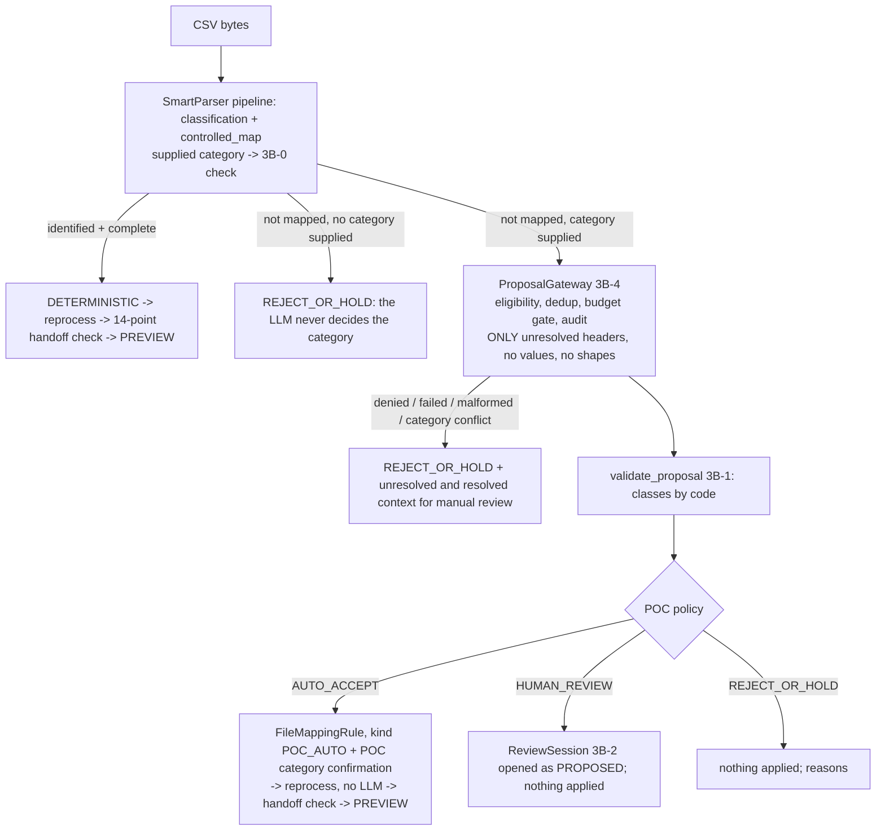

# UC-042 Smart Parser: Phase 3B-6 implementation report

**Automated LLM-assisted mapping orchestration. 18 November 2026.**

**Working copy:** `C:\Users\artlptp263user\p10\smartparser_phase1`. The UC-042 tree was used read-only.

**Status:**
- **Implemented and tested:** orchestration of the existing components; the POC decision policy (AUTO_ACCEPT, HUMAN_REVIEW, REJECT_OR_HOLD); a non-human `POC_AUTO` approval identity; an evaluation extension (34 cases).
- **Implemented but disabled:** the shipped POC policy (`enabled: false`) and the live provider (unchanged).
- **Blocked by owner decisions:** live provider, value-shape transmission, budgets, enabling the POC policy outside tests, production approval roles.

**All proposal metrics here are SIMULATED from recorded responses. They say nothing about a live model.**

## 1. Inspection findings and plan

The code was verified against the 3B-2 to 3B-5 reports before any change; they matched. There were 395 tests at the start.

**Reused unchanged:**
- the classifier and the 3B-0 supplied-category check;
- registry lookup and `controlled_map`;
- `build_request`: unresolved columns only, resolved columns as fixed context, no values;
- `ProposalGateway`: flags, budget, deduplication, retry, audit;
- `validate_proposal` and its five classes;
- the review state machine, `RuleStore`, `FileMappingRule`, `reprocess`, `check_handoff` and `write_preview`.

**Missing before this phase:**
- a single orchestrator;
- a separately configured decision policy;
- a way to record a policy decision without impersonating a person;
- fixtures for safe auto-accept cases;
- evaluation of the combined flow.

**Plan executed:** add `smartparser/orchestration/` (`policy.py`, `orchestrator.py`, and a shipped disabled policy), a `POC_AUTO` approval kind, fixtures, tests and `tools/eval_3b6.py`, with no rebuild of existing components.

## 2. Architecture changes and execution flow

**Deterministic-first:**
- The LLM is never called when the deterministic rules map the file. Tested on canonical, reordered, case and whitespace variants and an approved alias, across 4 categories and in the evaluation.
- Resolved columns are fixed context and are never re-proposed.
- Unknown columns are never dropped.
- Category conflicts are held, never switched.

## 3. Files created and modified

**New**

| File | Purpose |
|---|---|
| `smartparser/orchestration/__init__.py`, `orchestrator.py` | `MappingOrchestrator.process(data, filename, period, category)` returns a `WorkflowResult` |
| `smartparser/orchestration/policy.py` | `PocAutoAcceptPolicy`, `decide()`, `Decision` |
| `smartparser/orchestration/poc_auto_accept_policy.json` | Shipped **DISABLED** |
| `tests/test_orchestration_3b6.py` | 42 tests |
| `tests/fixtures/orchestration/poc_auto_accept_enabled.json` | TEST-ONLY enabled policy |
| `tests/fixtures/recorded_llm/{in10_auto_clear,in02_auto_clear,in10_amount_only,in10_partial_plausible,in10_auto_invented}.json` | Recorded responses |
| `tools/eval_3b6.py`, `corpus/phase3b6_eval/` | Evaluation extension (34 cases; reuses the `eval_3b5` builders and environment) |

**Modified (additive)**

| File | Change |
|---|---|
| `mapping/governed.py` | `Approval.approval_kind` adds `POC_AUTO` |
| `review/audit.py` | Event type `POC_AUTO_DECISION`; `approval_kind` adds `POC_AUTO` |
| `ai/gateway.py` | **Data-minimisation fix.** The proposer now receives the request **without value shapes** unless `AI_SEND_VALUE_SHAPES` is on. Before this, only the hashed payload omitted them. |
| `pyproject.toml` | Package data |

**Unchanged:** the production authority policy, the AI feature flags, the production rule files, the validator and all existing tests.

## 4. POC auto-accept policy and decision rules

**Configuration** (`PocAutoAcceptPolicy`):

| Setting | Shipped value | Meaning |
|---|---|---|
| `enabled` | **false** | Master switch for auto-acceptance |
| `accept_plausible` | false | Only CLEAR columns may be auto-accepted |
| `accept_supplied_category` | false | Whether a caller-supplied category may count as confirmed |

A `DISABLED` policy file may not enable anything; the loader refuses it. Tests use a TEST-ONLY fixture with `enabled` and `accept_supplied_category` true and `accept_plausible` false.

**Decision order** (`decide()`; the first rule that applies wins):

| Decision | When |
|---|---|
| **REJECT_OR_HOLD** | No proposal (provider disabled, budget denied, provider error, malformed response); the proposal was rejected (wrong category); any CONFLICT_INCOMPLETE column (duplicate or conflicting assignment, header mismatch, value-rule conflict); any NO_MATCH column (invented field, explicit UNMAPPABLE in either form, unaddressed column); any required field unresolved. The orchestrator also holds: no supplied category; a category conflict with the content (3B-1 gate); an ineligible request. |
| **HUMAN_REVIEW** | Any AMBIGUOUS column (alternatives, or a sign- or perspective-sensitive money or debit/credit field, even when the proposer said CLEAR at 0.99); any PLAUSIBLE column unless allowed; the policy is not enabled; the policy does not accept a supplied category. |
| **AUTO_ACCEPT** | Policy enabled; every unresolved column CLEAR; no conflict; every required field covered. |

**What AUTO_ACCEPT creates:**
- **One `FileMappingRule` only**, for this intake and SHA-256, with `approval_kind = POC_AUTO`, approver `POC_AUTO_ACCEPT_POLICY:<policy_id>` and role `poc_auto_accept`.
- **A POC category confirmation** (kind `POC_AUTO`).
- Audit events: `POC_AUTO_DECISION`, `RULE_CREATED`/`RULE_ACTIVATED` (`reusable: false`) and `CATEGORY_CONFIRMED` (scope `POC_SUPPLIED_CATEGORY`).
- **No alias or layout** is ever created (tested).
- The production authority policy is not used or changed, and test identities are not converted into permissions.

**What follows AUTO_ACCEPT:** deterministic reprocessing (0 LLM calls), the 14-point handoff check, and a PREVIEW. The sidecar adds `workflow_decision` (decision, reasons, policy ID, `approval_kind: POC_AUTO`).

**The confidence score is never used.** Classes come from the deterministic validator.

## 5. Synthetic test dataset (`corpus/phase3b6_eval`, 34 cases)

**What each case records:** case ID and type; input (supplied) category; true category; incoming headers; data SHA-256; recorded response (if any); AI mode; setup; and the expected outcome (deterministic mappings, unresolved headers, validation classes, final decision, canonical output SHA-256).

| Group | Cases | Expected decision |
|---|---|---|
| Canonical, reordered, case and whitespace (IN-02, IN-07, IN-09, IN-10, IN-13) | 15 | DETERMINISTIC (output = canonical file) |
| Approved alias (IN-11) | 1 | DETERMINISTIC |
| Unfamiliar but clear (IN-10 three columns, IN-02 two columns) | 2 | AUTO_ACCEPT (output = canonical file) |
| Ambiguous; sign-sensitive (`txn_amt`, proposer says CLEAR); partial (CLEAR + PLAUSIBLE) | 3 | HUMAN_REVIEW |
| Duplicate target; invented field; missing required; malformed; UNMAPPABLE A, B, C; provider disabled; budget refused; 3 category mismatches; no category | 13 | REJECT_OR_HOLD |

**Rebuild:** byte-identical (tested).

**Sources:** generated copies of the canonical September files (UC-042 `set_01` copies) and recorded responses only.

## 6. Individual test results (`tests/test_orchestration_3b6.py`, 42 passed)

| Brief item | Test(s) | Result |
|---|---|---|
| A, B, C Canonical, reordered, case/whitespace | `test_deterministic_files_never_call_the_llm` (4 categories × 3) | DETERMINISTIC; 0 calls; preview equals canonical |
| D Approved alias | `test_existing_approved_alias_is_deterministic` | DETERMINISTIC; 0 calls |
| E Unfamiliar, clear | `test_unfamiliar_clear_headers_are_auto_accepted_and_reprocessed` (IN-10, IN-02) | AUTO_ACCEPT; only the unresolved headers sent; correct schema; no shapes; `POC_AUTO`; preview equals canonical; no alias or layout |
| F Ambiguous | `test_ambiguous_headers_go_to_human_review` | HUMAN_REVIEW; session PROPOSED; nothing applied |
| G Duplicate targets | `test_blocking_cases_are_rejected_or_held[duplicate]` | REJECT_OR_HOLD |
| H Missing required | `…[short_example]` | REJECT_OR_HOLD |
| I Unknown canonical field | `…[auto_invented]` | REJECT_OR_HOLD (`INVALID_CANONICAL_FIELD`) |
| J Sign-sensitive | `test_sign_sensitive_field_is_never_auto_accepted…` | HUMAN_REVIEW (AMBIGUOUS despite a CLEAR claim) |
| K Malformed | `…[malformed]` | REJECT_OR_HOLD |
| L Provider disabled | `test_provider_disabled_holds_for_manual_review` | REJECT_OR_HOLD; 0 calls; manual review |
| M Budget gate | `test_budget_gate_refusal_holds` | REJECT_OR_HOLD (daily limit) |
| N Category mismatch | `test_category_mismatch_is_held_without_switching` (IN-09/10, IN-07/08, IN-05/06) | REJECT_OR_HOLD; 0 calls; no switch |
| O Partial success | `test_partial_success_plausible_column_goes_to_review` | 5 resolved deterministically + 3 proposed; HUMAN_REVIEW |
| P Reprocessing after auto-accept | `test_reprocessing_after_auto_accept_never_calls_again_and_is_repeatable` | 0 calls (proposal path patched to raise); identical mapping and records |
| Q Human-review routing | F, J and O plus `test_disabled_policy_never_auto_accepts`, `test_supplied_category_requires_policy_permission` | Review session opened; nothing applied |
| R Repeated processing | `test_repeated_processing_of_the_same_file_gives_the_same_decision_and_output` | Same decision, preview bytes and hash |

**Further tests:**
- explicit UNMAPPABLE in both forms plus the already-mapped form, held with no false duplicate;
- no values in the request;
- an unknown file with no category is held;
- a held file still reports its unresolved and resolved context;
- the policy never uses proposer confidence;
- the shipped policy and production state are unchanged;
- production rule files are untouched by orchestration;
- the evaluation dataset is reproducible;
- 34/34 evaluation cases pass, with metric invariants.

## 7. Full regression results (executed 18 Nov 2026)

| Suite | Result |
|---|---|
| **3B-6** | **42 passed** |
| 3B-5 | 16 passed |
| 3B-4 | 14 passed |
| 3B-3 | 15 passed |
| 3B-2 | 23 passed |
| 3B-1 (including the UNMAPPABLE correction) | 40 passed |
| 3B-0 | 117 passed |
| Phase 1 and original | 136 passed |
| Phase 2 | 34 passed |
| **Full suite** | **437 passed** (395 before this phase) |
| Full suite with `UC042_ROOT=/nonexistent` | 434 passed, 3 skipped |
| Registry `--check` | in sync, 19 definitions |
| Phase 1 baseline | **445/445** |
| Phase 2 corpus | **161/161** |
| 3B-5 evaluation | **68/68** |
| 3B-6 evaluation | **34/34** |

## 8. Deterministic mapping metrics (3B-6 evaluation)

| Measure | Value |
|---|---|
| Files fully mapped deterministically | 16/16 expected |
| Column mappings checked / correct | 225 / 225 |
| LLM calls on fully mapped files | 0 |

## 9. LLM proposal metrics (SIMULATED: recorded responses, not a model)

| Measure | Value |
|---|---|
| Proposer calls | 12 |
| Proposed columns with ground truth | 36 |
| Matching the ground truth | 32. The 4 non-matches are deliberately wrong recorded responses: duplicate target, invented field, UNMAPPABLE A and C. |
| Validation classes | CLEAR 18, PLAUSIBLE 7, AMBIGUOUS 5, CONFLICT_INCOMPLETE 2, NO_MATCH 8 |

**End to end:**
- decisions DETERMINISTIC 16, AUTO_ACCEPT 2, HUMAN_REVIEW 3, REJECT_OR_HOLD 13, all **34/34 as expected**;
- 18 eligible previews, all equal to the expected canonical output;
- auto-accept approval kinds: `POC_AUTO` × 2;
- **0 LLM calls during reprocessing.**

Tokens, cost and latency were **not measured**: there is no live provider.

## 10. Provider status and outstanding owner decisions

- **The live provider stays disabled:**
  - `DisabledLiveProvider`;
  - `AI_MAPPING_ENABLED` defaults to false;
  - no credentials, no network imports (`grep`: 0), no provider, model or region selected, no budgets invented.
- **Value shapes are not sent.** `AI_SEND_VALUE_SHAPES` is false, and this phase made that true for the proposer itself as well as for the hashed payload.

**Owner decisions:**
1. **Enabling the POC policy** outside tests (`status: POC_OWNER_ENABLED`), and whether a **caller-supplied category may count as confirmed** (`accept_supplied_category`).
2. **Whether PLAUSIBLE columns** may ever be auto-accepted (`accept_plausible`, default false).
3. **Live provider details** (provider, model, region), value shapes, token, call and cost limits, and live evaluation.
4. **Production approval roles** (from 3B-2), the handoff format (from 3B-3) and D-1. None of these changed.

## 11. Protected-path integrity

SHA-256 manifests were taken before Phase 1 and re-checked after this phase.

| Item | Result |
|---|---|
| UC-042 code (107 `.py` files) | Unchanged |
| UC-042 datasets (624 files) | Unchanged |
| Desktop Smart Parser (63 files) | Unchanged |
| Files in the UC-042 tree newer than the start of Phase 1 | 0 |
| Clone E, the original application, audit packs | Not opened |
| Production rules | 0 aliases, 0 layouts, 19 proposals all `proposed` |
| Production authority policy | No roles |
| Shipped POC policy | `DISABLED` |

Nothing was deployed, submitted or copied to the Desktop.

## 12. Known limitations and recommended next steps

**Limitations**
- **Recorded responses only.** All proposal quality is simulated; real-model behaviour is unknown.
- **Only 2 auto-accept cases**, both IN-10 and IN-02 with non-financial columns. By design, any money or debit/credit column always needs a person, so financial categories with renamed money columns will **never** auto-accept under this policy.
- **Auto-acceptance is per upload.** A second upload of the same layout triggers a new proposal (and, with a live provider, a new call). Reuse needs a human-approved alias or layout (3B-2); the POC deliberately never creates one.
- **The POC category confirmation** relies on the caller-supplied category. It is labelled `POC_AUTO`, not human. Handoff check 1 accepts it because a confirmation ID exists, so **the sidecar's `workflow_decision` must be read to tell POC from human confirmation**.
- **No UI.** Human review is the 3B-2 Python API.

**Recommended next steps**
1. The owner reviews this report and runs `pytest tests/test_orchestration_3b6.py -v` and `py -3.11 tools/eval_3b6.py run`.
2. Decide items 1 and 2 in section 10, and the production approval roles.
3. Supply real or BA-authored non-canonical files to extend `corpus/phase3b6_eval`.
4. Only after explicit authorisation: implement a concrete provider adapter behind the existing gateway, and run a budgeted live evaluation against that data.

**Every required test and integration step in the brief was executed. Nothing remains unfinished within the authorised scope.**
