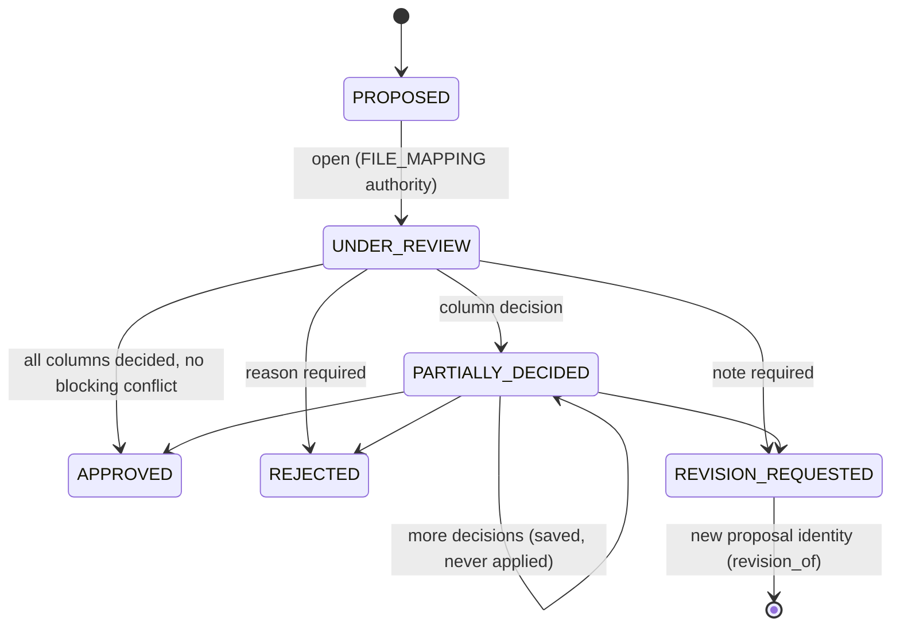

# UC-042 Smart Parser: Phases 3B-2 to 3B-5, consolidated report

**18 November 2026.**

**Working copy:** `C:\Users\artlptp263user\p10\smartparser_phase1`. The UC-042 tree `p10\uc042_token_optimisation` was used read-only.

**Phase reports:**
- `docs/UC042_SMART_PARSER_PHASE3B2_REPORT.md`
- `docs/UC042_SMART_PARSER_PHASE3B3_REPORT.md`
- `docs/UC042_SMART_PARSER_PHASE3B4_REPORT.md`
- `docs/UC042_SMART_PARSER_PHASE3B5_REPORT.md`

**Status labels used throughout:**
- **[Tested]:** implemented and tested;
- **[Disabled]:** implemented but disabled;
- **[Blocked]:** blocked by an owner decision;
- **[Not impl.]:** not implemented.

## Summary

| Phase | What exists now | Status |
|---|---|---|
| 3B-2 | A review state machine, three separate approval scopes, a configurable authority policy, a governed rule store with versions, revocation and supersession, and a hash-chained audit log | [Tested]. Business approvals are [Blocked]: the production policy authorises nobody. |
| 3B-3 | Deterministic reprocessing from stored originals, a 14-point handoff checklist, and the PREVIEW-only canonical writer with its provenance sidecar | [Tested]. UC-042 submission is [Disabled]. |
| 3B-4 | Feature flags (AI off by default), a budget gate, deduplication, timeout and one retry, a versioned prompt and schema, audited calls, and fallback to manual review | [Tested]. The live provider is [Disabled] and [Blocked]. |
| 3B-5 | A 68-case synthetic evaluation (22 case types, all 25 required items), scenarios A to J, separate metrics, and the UNMAPPABLE correction regression | [Tested]. Live evaluation is [Not impl.] and [Blocked]. |

**Final regression:**

| Check | Result |
|---|---|
| Tests | **395 passed** (327 before this work; +68 new) |
| Without the UC-042 tree | 392 passed, 3 skipped |
| Registry | in sync, 19 definitions |
| Phase 1 baseline | **445/445** |
| Phase 2 corpus | **161/161** |
| Evaluation | **68/68** |
| Protected files | Unchanged |
| Active aliases / approved proposals / layouts | **0 / 0 / 0** |
| Live calls | None |

**Nothing was deployed, submitted or copied to the Desktop project.**

The work was paused once at the owner's request, after 3B-2 had been completed and fully regressed, and resumed from that state.

## 1. Starting baseline (verified before starting)

- 327 tests passing.
- 445/445 Phase 1 baseline and 161/161 Phase 2 corpus.
- Registry in sync.
- 0 approved aliases.
- The Phase 3B-1 UNMAPPABLE correction in place, with 40 proposal tests.

## 2. Architecture inspected

- **Proposal path (3B-1):** `mapping/proposals.py` and `mapping/proposal_runner.py`, with `ai/proposer.py` (`MappingProposer`, `RecordedResponseStub`).
- **Controlled mapping (`mapping/controlled.py`):**
  - aliases from the catalogue;
  - `is_controlled` routing (3B-0);
  - the pipeline's `_confirm_forced_category`.
- **Intake:** `EvidenceStore` (per-upload `evidence_id`, content-addressed originals).
- **`TemplateRegistry`:** used only by the synthetic scored path and generic `map_columns`; not reached by UC-042 categories since 3B-0.
- **Module names:** the earlier designs' names (`registry/`, `validate/`) do not exist. The real modules are `schemas/` and `validation/`.

## 3. Phases: objective and implementation

| Phase | Objective | Key implementation |
|---|---|---|
| **3B-2** | Human review and governed approvals | `review/session.py`, `review/authority.py` and `authority_policy.json`, `review/approvals.py`, `review/audit.py`, `mapping/governed.py`, `mapping/rule_store.py`. `controlled_map` applies layouts and file mappings inside its all-or-nothing checks. |
| **3B-3** | Reprocessing and handoff | `handoff/reprocess.py`, `handoff/eligibility.py`, `handoff/writer.py` |
| **3B-4** | Provider architecture, disabled | `ai/config.py`, `ai/prompting.py` and `ai/prompts/mapping_prompt_v1.md`, `ai/gateway.py` |
| **3B-5** | Evaluation | `tools/eval_3b5.py`, `corpus/phase3b_eval/` |

## 4. Files created and modified (this assignment)

**New**

| Area | Files |
|---|---|
| Rules | `smartparser/mapping/{governed,rule_store}.py`, `mapping/rules/approved_layouts.json` (empty) |
| Review | `smartparser/review/{__init__,audit,authority,session,approvals}.py`, `review/authority_policy.json` (no roles) |
| Handoff | `smartparser/handoff/{__init__,reprocess,eligibility,writer}.py` |
| AI | `smartparser/ai/{config,prompting,gateway}.py`, `ai/prompts/mapping_prompt_v1.md` |
| Tools and data | `tools/eval_3b5.py`, `corpus/phase3b_eval/` |
| Tests | `tests/{phase3b_support,test_review_3b2,test_handoff_3b3,test_provider_3b4,test_evaluation_3b5}.py`, `tests/fixtures/review/test_authority_policy.json` (TEST_ONLY) |
| Reports | `docs/UC042_SMART_PARSER_PHASE3B{2,3,4,5}_REPORT.md` and this report |

**Modified (all additive; no existing behaviour weakened)**

| File | Change |
|---|---|
| `mapping/controlled.py` | Layouts, file mappings, `file_identity`, active-only aliases, strict loading, registry-hash checks, collision checks; `rule_id`/`rule_version` on mappings |
| `classify/csv_classifier.py` | The automatic tier ignores file mappings |
| `mapping/proposals.py` | `ProposalRecord.revision_of` |
| `mapping/proposal_runner.py` | `revision_of`; outcome fields `manual_review_required`, `deduplicated`, `gate_reasons` |
| `models/enums.py` | `APPROVED_LAYOUT`, `APPROVED_FILE_MAPPING` |
| `models/results.py` | `ColumnMapping.rule_id`, `rule_version` |
| `intake/store.py` | `EvidenceStore.find` |
| `pyproject.toml` | Package data |

**No existing test was edited.**

## 5. Review and approval state machine



**Column actions:** APPROVE, CHANGE (same category only, re-validated), REJECT, LEAVE_UNMAPPED.

**NO_MATCH (including both UNMAPPABLE forms) and CONFLICT columns can never be approved as proposed.**

**APPROVED does not mean complete:** `final_summary` records the missing required fields and unmapped columns.

## 6. Approval scopes and authority configuration

| Scope | Record | Matches | Authority (test policy: provisional roles) |
|---|---|---|---|
| File-specific mapping | `FileMappingRule` | One intake ID + SHA-256 + exact header list, and **only once the category is confirmed** | FILE_MAPPING (analyst) |
| Header alias | Catalogue entry + active alias | Any file of the category with that header (case and whitespace under policy). Sign-sensitive fields refused. | ALIAS (data_owner) |
| Source-system layout | `LayoutRule` with a declared source system and version | The exact ordered header list only | LAYOUT (data_owner **and** system_owner, 2 approvers) |
| Category confirmation / conflict | `CategoryConfirmation` | One upload | CATEGORY_CONFIRMATION / CATEGORY_CONFLICT |
| Revocation | Lifecycle change | One rule version | REVOCATION |

- **Production:** `review/authority_policy.json` is `PRODUCTION_UNCONFIGURED`, with **no roles and no test identities**. Every approval is refused (tested for all scopes).
- **Approval kinds:** BUSINESS approvals need an `OWNER_APPROVED` policy. TEST approvals need `allow_test_identities`. Every record carries `approval_kind`.

## 7. Audit and rule lifecycle

**Rules:**
- Rules are versioned and **never deleted**.
- `revoked` and `superseded` rules stay on file and never match.
- Earlier results keep their `rule_id`/`rule_version`.
- Each rule is bound to the category's registry-definition hash.
- The rule store refuses the packaged production directory and rolls back invalid writes.

**Audit:**
- Append-only JSONL with a SHA-256 hash chain.
- Malformed events are refused, and edits or deletions are detected by `verify()`.
- Events cover review, decisions, approvals and rejections, revisions, rule creation, activation, revocation and supersession, category confirmations, provider calls and deduplication.

## 8. Deterministic reprocessing

1. Load the stored original and verify its SHA-256.
2. Verify the intake.
3. Establish the category (deterministic, or from a confirmation for this upload).
4. Load the governed rules with this upload's identity.
5. Run the normal pipeline.

**Isolation:** an in-memory evidence store is used, so no new intake record is created. **0 provider calls**, proven by replacing `run_proposal` with a function that raises.

**Reproducible:** identical mapping and records on repeat (tested).

## 9. Handoff eligibility and canonical writer

**The 14 checks** (3B-3 report §3): category basis; complete mapping; every field exactly once; no duplicates; no missing required fields; no unmapped columns; allowed methods only; valid rule IDs and versions; no revoked or superseded rule; 0 validation errors; 0 nonconforming rows; **source cells identical to the stored bytes**; complete provenance; D-1 serialisation.

**The writer:**
- reorders columns only, keeps cells as source strings, and self-checks its output;
- refuses ineligible files and the UC-042 tree;
- writes `PREVIEW_ONLY_NOT_AUTHORISED_FOR_UC042_SUBMISSION__…csv` plus a full provenance sidecar.

`submit_to_uc042()` always raises.

**Evidence:** 47/47 eligible evaluation previews are **byte-identical to the canonical UC-042 source file**, including the unfamiliar-header file approved through a file mapping.

## 10. Provider adapter and feature flags

- **Flags:** `AI_MAPPING_ENABLED` (default false), `AI_PROVIDER`, `AI_MODEL`, `AI_REGION`, `AI_STORE` (false), `AI_MAX_OUTPUT_TOKENS`, `AI_MAX_CALLS_PER_DAY`, `AI_MAX_COST_PER_DAY`, `AI_TIMEOUT_SECONDS` (30), `AI_MAX_RETRIES` (1), `AI_SEND_VALUE_SHAPES` (false). There is no credential field.
- **`DisabledLiveProvider`** always raises and imports no network library. `grep` finds no network import anywhere in `smartparser/`.
- **The recorded stub** remains the only working proposer, for tests only.

## 11. Budget, deduplication and audit controls

- **Budget gate:** denies if AI is disabled, the provider is unavailable, any owner limit is unset, `store=true`, or a daily limit is reached. Denials go to manual review and are audited.
- **Deduplication:** keyed on the exact ordered header fingerprint, category, registry hash and prompt version. A pending proposal is reused.
- **Timeout:** with one retry on timeouts or provider errors. Malformed responses are rejected strictly, not retried.
- **Call audit:** provider, model, prompt and schema version, registry hash, input and output hashes, usage, duration, retries, status, error category. **No credentials.**
- **Usage ledger:** cost is recorded only when the provider reports it; nothing is estimated.

## 12. Evaluation dataset and metrics

There are 68 generated cases (the 3B-5 report has the full table):
- 14 categories × canonical, reordered and case/whitespace;
- alias approved, and alias proposed only;
- unfamiliar, ambiguous, duplicate target, missing required, extra column;
- 6 wrong-category directions;
- sign perspective, prompt injection, malformed response;
- 3 UNMAPPABLE forms;
- provider disabled, budget exceeded, duplicate pending;
- approved layout, revoked layout;
- D-1 rejection, preview.

**Metrics are reported separately:** classification, proposal quality, review, reprocessing, handoff and operations.

**Headline facts:**
- 0 provider calls during reprocessing;
- 6/6 wrong categories rejected;
- 47 eligible and 21 ineligible, each with reasons;
- 47/47 previews byte-identical to source;
- tokens, cost and latency **not measured**.

The proposal-quality figure (29/32) reflects hand-recorded, partly deliberately wrong stub responses. **It is not a model-quality measure.**

## 13. Explicit UNMAPPABLE correction regression

Forms A, B and C all give **NO_MATCH / `unmappable`**, with the diagnostic `UNMAPPABLE` only:
- in form B, the named field is kept for diagnostics only;
- in form C, there is no false duplicate or already-resolved conflict.

**Verified at every layer:**
- the 3B-1 validator (40 tests);
- review (an UNMAPPABLE column cannot be approved, 3B-2);
- handoff (the file stays ineligible);
- the gateway (3B-4);
- the evaluation (3B-5).

`test_regression_would_fail_against_pre_correction_rule` puts back the old rule. Form B then becomes AMBIGUOUS, and the evaluation flags it.

## 14. End-to-end scenario results

| Scenario | Result |
|---|---|
| A Deterministic success | Pass: 14/14; 0 calls; eligible; byte-identical previews |
| B Controlled variation | Pass: 28/28; 0 calls |
| C Unfamiliar, clear | Pass: proposal, review, approval, file mapping, confirmation, reprocess (0 calls), eligible, preview equals canonical IN-10 |
| D Ambiguous financial field | Pass: AMBIGUOUS; no automatic approval; ineligible |
| E Explicit UNMAPPABLE (A, B, C) | Pass: NO_MATCH, `unmappable`; ineligible |
| F Missing required fields | Pass: approved with 4 missing fields recorded; ineligible |
| G Revoked rule | Pass: stops matching; history intact |
| H Provider unavailable or budget | Pass: 0 calls; manual review; deterministic path unaffected |
| I Approved layout, AI disabled | Pass: deterministic, reproducible, 0 calls |
| J Wrong category (6 directions) | Pass: 3B-0 rejection unchanged; no switching |

## 15. Exact test commands and results (run on 18 Nov 2026, in the working copy)

```
py -3.11 -m pytest -p no:cacheprovider -q tests/test_evaluation_3b5.py      16 passed
py -3.11 -m pytest -p no:cacheprovider -q tests/test_provider_3b4.py        14 passed
py -3.11 -m pytest -p no:cacheprovider -q tests/test_handoff_3b3.py         15 passed
py -3.11 -m pytest -p no:cacheprovider -q tests/test_review_3b2.py          23 passed
py -3.11 -m pytest -p no:cacheprovider -q tests/test_proposals.py           40 passed   (3B-1 incl. correction)
py -3.11 -m pytest -p no:cacheprovider -q tests/test_forced_category.py    117 passed   (3B-0)
py -3.11 -m pytest -p no:cacheprovider -q tests/test_registry.py tests/test_classification_baseline.py \
                                            tests/test_units.py tests/test_csv_scenarios.py   136 passed  (Phase 1 + original)
py -3.11 -m pytest -p no:cacheprovider -q tests/test_controlled_mapping.py  34 passed   (Phase 2)
py -3.11 -m pytest -p no:cacheprovider                                     395 passed
UC042_ROOT=/nonexistent py -3.11 -m pytest -p no:cacheprovider             392 passed, 3 skipped
py -3.11 tools/eval_3b5.py run                                              68/68 pass
```

**Per-phase regression:**

| After | Full suite |
|---|---|
| 3B-2 | 350 passed |
| 3B-3 | 365 passed |
| 3B-4 | 379 passed |
| 3B-5 | 395 passed |

Baseline 445/445, corpus 161/161 and registry in sync were confirmed after each phase.

**Evidence:** `Downloads\UC042_SMART_PARSER_PHASE3B\{3B2,3B3,3B4,FINAL}_evidence\`.

## 16. Phase 1 and Phase 2 regressions

| Check | Result |
|---|---|
| Phase 1 baseline | 445/445, 0 incorrect, unknown or ambiguous (`tools/baseline_classification.py`) |
| Phase 2 corpus | 161/161 (`tools/evaluate_variation_corpus.py`) |

Both were confirmed after every phase.

## 17. Registry synchronisation

`python -m smartparser import-registry --uc042-root <UC-042 copy> --check`: **in sync, 19 definitions match.**

## 18. Protected-file integrity

**Method:** SHA-256 manifests taken before Phase 1, re-checked after every phase. Copies are in `FINAL_evidence/integrity_manifests/`.

| Item | Result |
|---|---|
| UC-042 code (107 `.py` files) | Unchanged |
| UC-042 datasets (624 files) | Unchanged |
| Original Desktop Smart Parser (63 files) | Unchanged |
| Files in the UC-042 tree newer than the start of Phase 1 | 0 |
| Clone E, the original UC-042 application, audit packs | Not opened |
| Production rules and policy | 0 aliases; 0 layouts; 19 proposals all `proposed`; policy has no roles |

## 19. Outstanding owner decisions

1. **Approval roles:** real roles for file mappings, aliases, layouts, category confirmation and conflicts, and revocation, and whether layouts need two approvers. Then set the policy to `OWNER_APPROVED`.
2. **Sign-sensitive aliases:** may a reusable alias target a sign-sensitive field?
3. **Handoff format:** is the canonical-layout re-serialisation plus sidecar an acceptable UC-042 submission? Does the sidecar enter UC-042's audit trail?
4. **D-1:** may non-canonical delimiters or encodings ever be eligible?
5. **Live provider:** provider, model, region and `store=false`; whether value shapes may be sent; token, call and cost limits (with currency); whether a live evaluation is authorised and its budget.
6. **Deployment locations:** for the rule store, audit log, usage ledger and preview output.
7. **Real test data:** BA-authored or real non-canonical files for a meaningful accuracy evaluation.

## 20. Deliberately disabled or not implemented

| Item | Status |
|---|---|
| Live LLM provider | [Disabled] (`DisabledLiveProvider`) and [Blocked] |
| Business approvals | [Blocked]: the production policy authorises nobody |
| UC-042 submission | [Disabled]: `submit_to_uc042` refuses; previews only |
| Non-canonical serialisation in handoff | [Disabled] by default (D-1) |
| Live evaluation; token, cost and latency measurement | [Not impl.] and [Blocked] |
| Frontend or review UI | [Not impl.]: Python API only |
| Value-level transformations, PDF field extraction, OCR, ZIP/XLSX intake, cross-file relationship enforcement | [Not impl.] (out of scope) |
| `TemplateRegistry` retirement | Not done: kept for synthetic schemas; UC-042 uses governed layouts only (tested) |

## 21. Known limitations and recommended next actions

**Limitations**
- **Synthetic evaluation only.** It proves the controls, not real-world accuracy. Proposal quality comes from recorded responses.
- **Test-only authorisation.** Approvals in tests use the TEST-ONLY policy. No BUSINESS approval path has been exercised end to end, because it requires an owner-approved policy.
- **Two design gaps were found and fixed in this assignment**, each caught by tests:
  - an invalid-transition ordering in `approve_proposal`;
  - **file mappings deciding a category during automatic classification**. They now apply only after a recorded confirmation.
- **No persistence service.** The review session, rule store, audit and ledger are file-based, for the POC.
- **No `revision_rate` or invented-field cases** in the evaluation. Both are covered by unit tests.

**Recommended next actions**
1. The owner reviews these reports and runs the scenario tests (`pytest tests/test_evaluation_3b5.py -v`).
2. Decide items 1, 3 and 4 in section 19, then configure an `OWNER_APPROVED` authority policy.
3. Provide real or BA-authored non-canonical sample files.
4. Only then, and with explicit authorisation, implement a concrete provider adapter behind the existing gateway and run a budgeted live evaluation.

**Stopping here, as instructed.**
