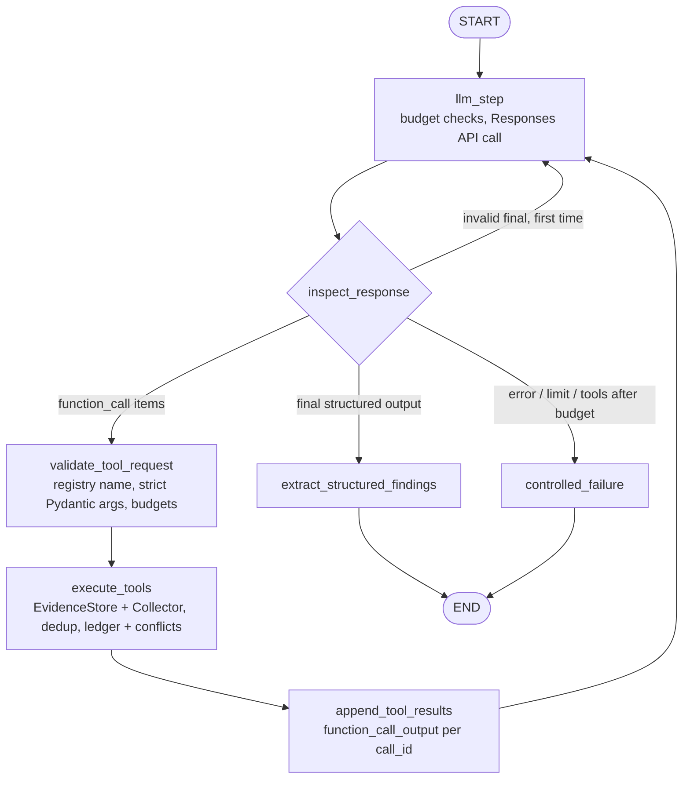

# UC-042 AI Investigation V2: bounded tool calling (implementation report)

2 Nov 2026. Model `gpt-6-luna` (OpenAI Responses API), Python 3.11, `openai` 3.42.1, `langgraph` 1.2.19, `pydantic` 2.14.2.

| Item | Status |
| --- | --- |
| V1 (fixed mode) | Unchanged and still the default (`UC042_INVESTIGATION_MODE=fixed`) |
| V2 (tools mode) | Implemented: nested LangGraph tool-calling subgraph, 8 read-only tools, evidence ledger, budgets |
| Automated tests | **290: 289 passing + 1 opt-in live test skipped** (256 pre-existing + 34 new in `tests/test_tool_calling.py`); offline tests need no API key |
| Live verification | **4 genuine gpt-6-luna investigations** with tool calls (SC2, S02, SC5A, S05), all VALID and published |
| Data integrity | 420 protected files (datasets, packs, golden snapshots, engine, pack layer, existing tests, tools) unchanged |

## 1. Architecture

The outer V1 graph is unchanged. Only the `ai_investigation` node branches on the mode.

```mermaid
flowchart TD
  S([START]) --> L[load_investigation_case] --> SC[identify_investigation_scope] --> R[route_investigation]
  R -.-> RT[retrieve_* (8 routes)] --> P[build_evidence_packet] --> AI{ai_investigation}
  AI -- fixed --> V1[V1 investigator: one structured call]
  AI -- tools --> SUB[[V2 tool-loop subgraph]]
  V1 --> V[validate_findings<br/>against packet or accumulated ledger]
  SUB --> V
  V --> PF[persist_findings] --> E([END])
  L & SC & R & RT & P -. error .-> V
```

The nested subgraph (`uc042lib/investigation/tool_loop.py`) is invoked from inside `ai_investigation` with its own state schema:



**The model only requests tools.** Python validates every request, executes it through the existing hash-verified `EvidenceStore`, and returns the records. There are no write tools, no filesystem access, no free-text predicates and no arbitrary joins.

## 2. Modes

| Variable | Values |
| --- | --- |
| `UC042_INVESTIGATION_MODE` | `fixed` (default, V1) or `tools` (V2). An unknown value is a configuration error. The CLI's `--mode` overrides it. |

Tools mode requires a tool-capable provider (`openai`). The offline simulator and the Anthropic legacy adapter fail with an explicit configuration error in tools mode; there is no silent switch. Library callers pass `mode=` to `run_investigation` / `investigate_pack`, and the default there is `fixed`.

## 3. Tool registry (`uc042lib/investigation/tools.py`, `uc042-evidence-tools/1.0`)

Every argument model is strict (`extra="forbid"`, strict types). The OpenAI definitions are generated from these models with `openai.pydantic_function_tool`: `type: function`, `strict: true`, `additionalProperties: false`, all fields required, optional values nullable. IDs use the engine's own identifier rule (`structure.ID_RE`). Dates are `YYYY-MM-DD` and are checked as real dates.

| Tool | Arguments | Constraints | Returns |
| --- | --- | --- | --- |
| `get_source_record` | `evidence_id` | `IN-01`..`IN-14` (CSV) only; no paths, no PDFs | One record or a NOT_FOUND search |
| `search_bank_entries` | `account_id`, `bank_reference?`, `date_from?`, `date_to?` | Known account; a reference, or a date range of at most 7 days | IN-09 entries (exact `bank_reference`/`end_to_end_ref`) |
| `get_cashbook_entries` | `account_id`, `payment_reference?`, `date_from?`, `date_to?` | As above | IN-10 entries |
| `get_settlement_batch` | `batch_id` | — | IN-12 header, IN-13 lines, IN-11 transactions referenced by lines; missing transactions become NOT_FOUND searches |
| `search_customer_transactions` | `client_id?`, `txn_id?`, `date_from?`, `date_to?`, `transaction_type?` | `txn_id` alone, or `client_id` + a range of at most 31 days; type from the schema enum | IN-11 transactions |
| `get_customer_balance_snapshots` | `client_id`, `currency`, `date_from`, `date_to` | One currency (GBP or EUR, never combined); at most 31 days | IN-03 snapshots |
| `get_reconciliation_evidence` | `account_id`, `currency`, `date` | The account's currency must match | IN-06, IN-07, IN-08, IN-05 for the date, plus IN-14 log entries referencing the IN-06 record; one search per component |
| `follow_relationship` | `evidence_id`, `relationship` | Source must already be in the ledger and of the right file type | The related record(s) via one whitelisted join |

Whitelisted relationships (source field, then target):

- `settlement_line_to_transaction` (`txn_id`)
- `settlement_line_to_batch` (`batch_id`)
- `transaction_to_batch` (`settlement_batch_id`)
- `refund_to_original_transaction` (`original_txn_id`)
- `settlement_batch_to_bank_entry` (`expected_bank_reference`, same account)
- `cashbook_to_bank_entry` (`payment_reference`, same account)
- `bank_entry_to_statement` (`statement_id`)
- `external_recon_to_confirmation` (`bank_statement_id` → confirmation `statement_id`)

`EvidenceStore.find`/`find_where` are used only inside these typed functions and are never exposed.

**Tool result returned to the model:**

```json
{"status": "OK|NOT_FOUND", "evidence_ids": [...], "new_evidence_ids": [...], "already_in_evidence": [...],
 "search_ids": ["SEARCH-nn"], "truncated": false, "not_added_evidence_limit": [], "note": "",
 "records": [{"evidence_id", "record_type", "source_file", "source_line", "retrieved_via", "join_key", "fields"}]}
```

Other statuses (`REJECTED`, `ERROR`, `DEDUPLICATED`, `BUDGET_EXHAUSTED`) carry an `error` or `note` instead. Internal exception details are kept in the transcript, not sent to the model. Provenance fields are always set by Python; argument models reject them.

## 4. Execution cycle (OpenAI Responses API)

1. **Request.** `OpenAIInvestigator.tool_turn` calls `client.responses.with_raw_response.parse(...)` with:
   - `model`;
   - `instructions` = `TOOLS_SYSTEM_PROMPT` (the V1 rules plus tool rules; `uc042-investigator-prompt/2.0-tools`);
   - `input` = the history;
   - `tools` = the 8 strict definitions;
   - `tool_choice="auto"` and `parallel_tool_calls=True`;
   - `text_format=LLMInvestigationOutput`, for the final answer;
   - `max_output_tokens`, `store=False` and `include=["reasoning.encrypted_content"]` (stateless reasoning replay);
   - optional `reasoning.effort`.

   No temperature or top_p is sent.
2. **Classify the response.** The raw body is checked first:
   - `failed` → `response_failed`;
   - `incomplete` → `max_output_tokens` or `incomplete`;
   - a refusal item → `refusal`.
3. **Tool calls.** `function_call` items yield `call_id`, `name` and `arguments` (a JSON string). The arguments are parsed and validated by our own Pydantic models, never by the SDK.
4. **Final answer.** Without function calls, the SDK's Pydantic parse produces `LLMInvestigationOutput`. Invalid or absent output gets one correction request.
5. **Return results.** The **complete** `response.output` (reasoning, function calls) is appended to the history unchanged. Then one `function_call_output` per `call_id`, in order, carrying the JSON result.
6. **Repeat** until a final answer, a limit, or an error.

Provider errors keep their V1 typed kinds: authentication, model_unavailable, rate_limit, timeout, bad_request and so on. A failed turn's token usage is still counted.

## 5. Evidence ledger

`packet.collector_from_packet` rebuilds a `Collector` from the packet or ledger. Tools add records through `Collector.add`, which preserves file ID, source line, primary key, file SHA-256, `retrieved_via` and `join_key`, and records relationships. Empty results become `SEARCH-nn` items, continuing the packet's numbering.

`packet.build_ledger` produces the accumulated evidence in packet form:

- deterministic conflict detection is **re-run over all records** (new conflicts are reported to the model);
- `allowed_citation_ids` is recomputed;
- the result is identified by `ledger_sha256` and `initial_packet_sha256`.

`validate_findings` validates citations against the ledger with the unchanged V1 rules. `evidence_ledger_sha256` is part of the findings and therefore of the `INV-…` identity.

## 6. Budgets (`config.tool_limits()`, environment-overridable)

| Limit | Default | Variable |
| --- | --- | --- |
| Tool calls per investigation (rejected and duplicate requests count) | 8 | `UC042_TOOLS_MAX_CALLS` |
| Model → tools → model rounds | 4 | `UC042_TOOLS_MAX_ROUNDS` |
| Records per tool call | 25 | `UC042_TOOLS_MAX_RECORDS_PER_CALL` |
| Total evidence records (packet + tools) | 160 | `MAX_RECORDS` (shared with V1) |
| Estimated input tokens per request (checked before sending) | 150,000 | `UC042_TOOLS_MAX_INPUT_TOKENS` |
| Overall wall-clock budget | 300 s | `UC042_LLM_TOTAL_TIMEOUT_SECONDS` |
| Output tokens per request | 8,000 | `UC042_LLM_MAX_TOKENS` |

**Duplicate calls:** a canonical key of tool name plus sorted validated arguments. A repeat is not re-executed. It returns the earlier IDs as `DEDUPLICATED` and counts toward the budget.

**Budget exhaustion:**

- no further tools run, and refused calls are answered `BUDGET_EXHAUSTED`;
- every tool output after the last permitted round tells the model to finish;
- the model gets exactly one opportunity to return findings;
- further tool requests end in `FAILED` with `budget_exhausted_without_findings`.

Nothing is fabricated.

## 7. Findings

`LLMInvestigationOutput` is unchanged. The four classes map to its existing sections:

- `EVIDENCE_BACKED` → `confirmed_findings`;
- `HYPOTHESIS` → `hypotheses`;
- `INSUFFICIENT_EVIDENCE` → `missing_evidence`;
- `CONFLICTING_EVIDENCE` → `contradictory_evidence`.

`InvestigationResult.classification_summary` is derived by Python, never by the model. It splits evidence gaps into:

- `engine_missing_evidence` (MISS items);
- `searched_not_found` (NOT_FOUND searches);
- `additional_gaps_identified_by_ai`.

It also lists unverified candidates, deterministic conflicts and not-found searches.

**New validation rule:** a statement that evidence "does not exist" or "never existed" is rejected. Absence from the supplied data is only "not found". Negated framing ("…not that such records never existed") and "does not exist in the supplied data" are accepted. The live S02 run exposed an over-rejection, which was fixed and covered by a test.

## 8. Persistence and audit trail

A VALID tools-mode result publishes atomically, in one `os.replace`:

- `findings.json`;
- `evidence_packet.json` (the initial packet);
- `evidence_ledger.json`;
- `tool_calls.json`;
- `runs/0001.json`.

The run record holds the SHA-256 of the ledger and transcript files. Artefacts are written as UTF-8 bytes, so recorded hashes match on Windows too. FAILED or REJECTED runs go to `investigations/_not_published/…` with the transcript and ledger embedded for diagnosis.

**How to read `tool_calls.json`.** Each entry records:

- `call_id` (the provider's), `tool`, `round`, validated `arguments` (or `raw_arguments` if rejected), `requested_at`;
- `status`: OK, NOT_FOUND, DEDUPLICATED, REJECTED, ERROR or BUDGET_EXHAUSTED;
- `deduplicated`, `evidence_ids`, `new_evidence_ids`, `search_ids`;
- `records_returned`, `truncated`, `latency_ms`, `error`.

`summary` gives LLM calls, rounds, stop reason and counts. `findings.json` → `model_metadata` holds the provider, model, prompt/workflow/tool-registry versions, token usage and every provider response ID.

## 9. Live results (genuine gpt-6-luna calls; not simulated)

| Scenario | Tool calls (rounds) | Tools (arguments abridged) | Records | Tokens in / out (reasoning) | Latency | Result |
| --- | --- | --- | --- | --- | --- | --- |
| SC2 `EXC-SC2-01` £2,868.50 | 6 (3) | `get_settlement_batch(SB-GBP-20260915)`, `get_reconciliation_evidence(SGA-GBP-01, 09-15)`, `follow_relationship` ×3 (batch→bank, cashbook→bank, recon→confirmation), `get_reconciliation_evidence(09-16)` | 30 → 44 | 79,361 / 4,073 (1,651) | 44.1 s | VALID, PARTIALLY_SUFFICIENT, `INV-EXC-SC2-01-389ba1328c3c` |
| S02 `EXC-S02-01` EUR 15 Sep | 7 (2) | `get_reconciliation_evidence(SGA-EUR-01, EUR, 09-15)`, `get_settlement_batch` ×2 (AQ/SB-EUR-20260915), `search_bank_entries` ×4 by exact reference → all NOT_FOUND | 14 → 27 | 47,128 / 6,090 (1,412) | 62.0 s | VALID, INSUFFICIENT_EVIDENCE, `INV-EXC-S02-01-764aed67bb83` |
| SC5A `EXC-SC5A-01` TX-0915-00009 | 1 (1) | `get_settlement_batch(SB-GBP-20260915)`: the line's transaction was again NOT_FOUND | 20 → 20 | 29,184 / 5,094 (2,480) | 51.5 s | VALID, PARTIALLY_SUFFICIENT, `INV-EXC-SC5A-01-fae6067d9d23` |
| S05 `EXC-S05-01` £812.40 | 2 (1) | `get_cashbook_entries(SGA-GBP-01, ref 'SETTLE 0417')` → NOT_FOUND, `get_reconciliation_evidence(SGA-GBP-01, 09-17)` | 47 → 48 | 53,802 / 4,985 (2,065) | 50.2 s | VALID, INSUFFICIENT_EVIDENCE, `INV-EXC-S05-01-51ba0f94bf82` |

**A first S02 run was REJECTED**: three tool calls, by the validator's false positive described in §7. It is kept under `_not_published/`. Re-validated offline with the corrected rule, it has zero violations. The table shows the fresh live run.

**Review of the live outputs:**

- Every money amount in every confirmed finding appears in the evidence the finding cites (automated cross-check); the SC5A line count and booking date were checked by hand.
- Causes appear only as hypotheses. SC5A's unverified candidate is discussed only as a hypothesis.
- All four exceptions remain OPEN (`NOT_RESOLVED_BY_INVESTIGATION`).
- NOT_FOUND evidence is described as "not found in the supplied data".
- One debatable item: S05's C-01 treats the internal reconciliation's 0.00 difference against the external −812.40 as a contradiction. These are different reconciliations, so a reviewer may reasonably disagree.

## 10. V1 compared with V2

| Aspect | V1 (fixed) | V2 (tools) |
| --- | --- | --- |
| Evidence | Pre-built packet | Packet plus model-requested records |
| Model calls | 1 (+1 corrective) | Up to rounds + 2 |
| Tools | None | 8 read-only, strict, Python-executed |
| Citation set | Packet | Accumulated ledger (hashed) |
| Conflict detection | On the packet | Re-run after every tool round |
| Artefacts | findings, packet, runs | Plus `evidence_ledger.json` and `tool_calls.json` |
| Versions | graph 1.1, prompt 1.0 | graph 2.0-tools, prompt 2.0-tools, tools 1.0 |

## 11. Limitations (as of the original V2 delivery; see §12.6 for the current list)

- **Token cost:** each round resends the history (packet + tool results). SC2 used about 79k input tokens, roughly 72% served from cache.
- **Token estimate:** the input-token check is an estimate (about 3 characters per token) made before each request, not an exact count.
- **Tool usage varies:** the model decides what to request. SC5A made one call that returned nothing new; the deterministic packet already held the evidence.
- **Validation is still pattern-based** and can over- or under-reject paraphrases (see §7).
- **Scope:** per-exception runs only; no PDF evidence tools; no checkpointer.

---

## 12. Addendum (2 Nov 2026): review findings, corrections and hardening

This addendum records corrections made after review. Everything above is the original V2 delivery and is kept as it was,
except two notes: §11's heading points here, and the `store=False` code comment was corrected. Earlier results, including
the rejected S02 run and the first S05 run, remain on disk unchanged.

### 12.1 S05 false contradiction: problem, rule and correction

**Problem.** The first live S05 run (`INV-EXC-S05-01-51ba0f94bf82`, prompt 2.0-tools) reported C-01 as contradictory
evidence. It set the internal reconciliation's 0.00 difference against the external reconciliation's −812.40.

The records show these are different reconciliation views that agree with each other:

| Record | View | Values on 2026-09-17 |
| --- | --- | --- |
| `IN-05:IRR-EMONEY-GBP-20260917` | Internal: client-money requirement vs resource, per currency | requirement 341,484.46 = resource 341,484.46 → **0.00** |
| `IN-06:ERL-SGA-GBP-01-20260917` | External: account ledger vs bank, per account | ledger 341,484.46 vs bank 340,672.06 → **−812.40** |

The internal resource (`item_a` 341,484.46) is the firm's own ledger figure, the same one on the external ledger side.
The real finding is an **unexplained difference** between the ledger and the bank; there is no contradiction between
the two reconciliations.

**Classification rules** (prompt `uc042-investigator-prompt/1.1` and `2.1-tools`; findings schema 1.3):

| Class | Meaning | Where it goes |
| --- | --- | --- |
| Actual contradiction | Same subject, period, account/scope **and** the same measure, materially disagreeing | `contradictory_evidence`; must name **exactly two** `compared_evidence` IDs and explain `same_measure_and_scope` |
| Different reconciliation views | Different calculations, measures or scopes (internal vs external; client vs account) | Not a contradiction; the difference is reported as a finding or open question |
| Unexplained difference | A difference exists and its cause is not established | Confirmed finding that it exists and is unexplained, plus missing evidence or hypotheses; never a cause or a contradiction |

**Deterministic checks** (`validation.py`, `_check_contradictions`):

- a contradiction needs two distinct compared IDs, both citable, and a substantive `same_measure_and_scope`;
- a MISS item, a NOT_FOUND search or an unverified candidate can never be one side;
- two compared IDs from **different classified reconciliation views** are rejected.

The views are taken from the engine's own result prefixes:

- internal: `IN-05`, `C04-REQUIREMENT`, `C05-RESOURCE`, `C06-DIFFERENCE`;
- external: `IN-06`, `IN-07`, `IN-08`, `C07-BANK-EVIDENCE`, `C08-DIFFERENCE`, `RC2-LEDGER`, `BC-VS-EOD`;
- client: `IN-03`, `CBAL-*`.

IDs outside these lists are not judged by the view rule. Different amounts on their own are never rejected.
Cause wording in a contradiction is rejected, as it already is for confirmed findings. Deterministic `CONF-` conflicts
(SC2's RESOLVED log against the OPEN exception; SC5D's recomputed against reported value) remain valid contradictions.
Older artefacts stay readable: the new fields have defaults that apply only when loading earlier findings.

### 12.2 S05 live regression run (genuine gpt-6-luna call; tools mode)

| Item | Value |
| --- | --- |
| Investigation | `INV-EXC-S05-01-2b3defdae13f`, PUBLISHED, VALID, INSUFFICIENT_EVIDENCE; exception **OPEN** (`NOT_RESOLVED_BY_INVESTIGATION`) |
| Versions | prompt `2.1-tools`, workflow `2.0-tools`, findings schema `1.3`, tools `1.0` |
| Tool calls (1 round) | `get_cashbook_entries(SGA-GBP-01, ref "SETTLE 0417")` → NOT_FOUND (SEARCH-03); `search_bank_entries(SGA-GBP-01, ref "SETTLE 0417")` → `IN-09:BE-GBP-0917-X01` (SEARCH-04); `get_reconciliation_evidence(SGA-GBP-01, GBP, 2026-09-17)` → IN-06, IN-07, IN-08, IN-05 |
| Evidence records | 47 → 48 |
| Tokens | input 55,093 (26,932 cached), output 5,590 (2,617 reasoning), total 60,683 |
| Latency | 56.6 s model calls (2 LLM calls); 58.4 s end to end |
| Contradictions | **0**. The summary states: "The internal reconciliation is a different view and reports no difference." |
| Manual check | Every cited ID is in the ledger; every amount in every confirmed finding appears in its cited evidence; the cause appears only as hypothesis H-01; `verify_published` VERIFIED |

The first S05 run (`…51ba0f94bf82`) is kept unchanged as history. It was valid under the rules of its time and would be
rejected under schema 1.3, because its C-01 names no compared pair and compares two different views.

### 12.3 Persistence integrity (V1 and V2 artefacts)

**Byte-level history.** No byte-level hash of the V1 artefact (`INV-EXC-SC2-01-eb2021ac50e9`) was recorded when it was
written: V1 run records carried no file hashes, and the earlier protected-file baselines excluded `investigations/`.
The byte-level comparison therefore starts from a snapshot taken at the start of this task, and the evidence that the
files were never rewritten is indirect but consistent:

- **Line endings:** all three V1 files still use CRLF (findings.json 225 CRLF and 0 LF-only lines; evidence_packet.json
  956/0; runs/0001.json 45/0). They were written in text mode before the byte-writing change. A rewrite by the current
  code would have produced LF-only bytes.
- **Timestamps:** the file modification times equal the recorded run time (2026-11-02 11:26:35 UTC, `runs/0001.json`).
- **Content:** the packet's self-hash and the findings' `evidence_packet_sha256` match. The `investigation_id`,
  recomputed from the findings exactly as stored (schema 1.1), equals the directory name. The result still loads with
  the current models as VALID.

**Correction to the original report.** The original report's statement that the byte-writing change "changes V1 files
from CRLF to LF" was imprecise. The change affects only **newly written** artefacts. No existing artefact was rewritten.

**Identity weakness found and fixed.** `investigation_id()` hashed the *current* model's dump. After fields were added,
artefacts written under an earlier schema could not be re-verified with it. Their content was unaffected.
`investigation_id_from_findings()` now hashes the stored fields; the result is identical for current-schema results.
The new `verify_published(path)` checks, read-only:

- the packet and ledger self-hashes and the findings' references to them;
- the recomputed ID;
- the run records' file hashes;
- that the findings still load.

All six published artefacts (V1, the first S05 and the four other V2 runs) report **VERIFIED**.

**Write-once bug found and fixed.** In `_not_published/`, two identical failures in the same second shared a file name
and `os.replace` overwrote the earlier record. Unpublished records now use exclusive creation (a hard link, or `xb`),
with a `-2`, `-3`… suffix on a clash. The existing record (`2026-11-02T115736+0000-10c4a727.json`) was not touched.

**Snapshot comparison for this task:**

- before: 24 artefact files;
- after: 29 files;
- changed: none; missing: none;
- added: only the five files of `INV-EXC-S05-01-2b3defdae13f`.

### 12.4 OpenAI data handling: corrected statement

An earlier summary said that with `store=False` "nothing is retained on OpenAI's side between rounds". **That was
incorrect.** Per OpenAI's official documentation (`developers.openai.com/api/docs/guides/your-data`, to which
`platform.openai.com/docs/guides/your-data` redirects; and the Responses API reference, *Create a model response*):

1. **Application state (`store`).** `store` defaults to `true`: "response data will be stored for at least 30 days".
   This project sends `store=False`, so the Responses API does not store the response as retrievable application state.
   Each round therefore resends the full input history.
2. **Abuse-monitoring logs are separate.** "By default, abuse monitoring logs are generated for all API feature usage and
   retained for up to 30 days", longer where legally required. They "can contain" prompts and responses. **`store=False`
   does not turn these off.**
3. **Zero Data Retention / Modified Abuse Monitoring.** Customer content can be excluded from abuse-monitoring logs only
   under ZDR or MAM, which "are subject to prior approval by OpenAI". They are configured at organisation level and
   project level (Settings → Organization → Data controls → Data Retention). Under ZDR, `store` is always treated as
   `false`. **This project has not established whether its OpenAI organisation has ZDR or MAM;** an API key and
   `store=False` cannot show it.
4. **Encrypted reasoning (`include=["reasoning.encrypted_content"]`)** "includes an encrypted version of reasoning tokens
   in reasoning item outputs". It enables reasoning items "to be used in multi-turn conversations when using the Responses
   API statelessly (like when the `store` parameter is set to `false` …)". It exists for continuity between rounds; it is
   not a retention control. The encrypted items travel back to OpenAI as part of each round's input.

**Accurate summary:** `store=False` prevents Responses API application-state storage. Prompts, evidence and responses
are still subject to OpenAI's default abuse-monitoring retention (up to 30 days), unless the organisation has approved
ZDR or MAM controls, which must be confirmed separately with the account owner. The implementation was correct and is
unchanged; only the description and a code comment were wrong.

### 12.5 Tests after hardening

`python -W error::ResourceWarning -m unittest`: **302 tests: 301 passed, 0 failed, 1 skipped** (the opt-in live test).
This is the 290-test baseline plus 12 new tests in `tests/test_review_hardening.py`:

- **7 classification tests:**
  - different internal/external views are rejected, including the exact S05 data;
  - the original live S05 contradiction shape is rejected;
  - same-measure contradictions are accepted, using SC5D and SC2 real conflicts;
  - missing scope, missing evidence, not-found searches and candidates are not proof of contradiction;
  - an unexplained difference stays unexplained (cause wording rejected);
  - the view mapping and prompt rules;
  - a rejected contradiction is not published.
- **5 persistence tests:**
  - a legacy CRLF artefact is never rewritten by an identical rerun;
  - an attempted overwrite is refused with bytes unchanged;
  - a new result never touches existing artefacts;
  - an earlier-schema artefact remains verifiable and tampering is detected;
  - `_not_published` records are preserved, including same-name failures.

No existing test was modified in this task.

### 12.6 Remaining limitations

- **Pattern-based validation.** Classification checks are rule-based; the reconciliation-view rule covers only the
  classified ID prefixes, and the model's judgement about "same measure" is otherwise not machine-verified.
- **Retention controls unconfirmed.** The OpenAI organisation's retention controls (ZDR or MAM) are not established;
  default abuse-monitoring retention must be assumed.
- **No V1 byte baseline.** The V1 artefact has no byte-level hash from its creation time; integrity rests on the evidence
  in §12.3. Artefacts written since V2 carry file hashes in their run records.
- **Unchanged from §11:** per-exception runs only, no PDF evidence tools, input-token check is an estimate, and token
  cost grows with rounds.
