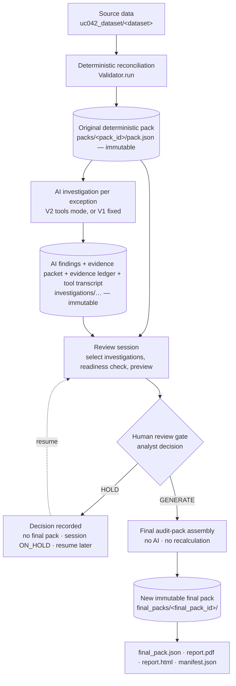
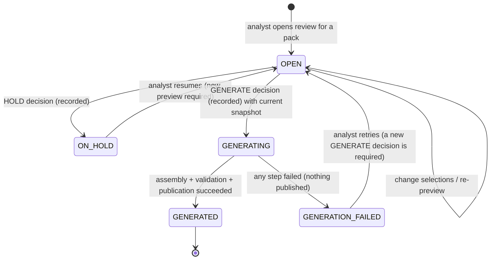
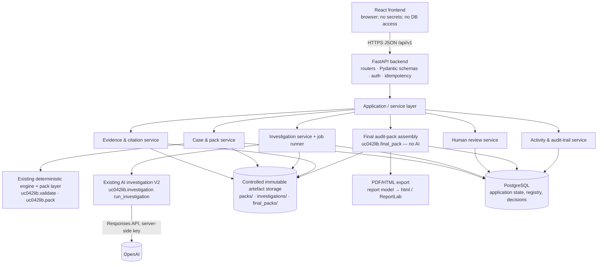
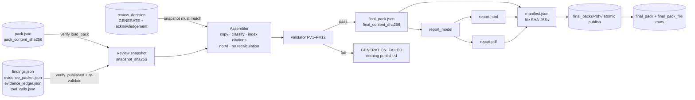

# 06 — Final Audit Pack, Human Review Gate, React Frontend and FastAPI Backend: Specification

Status: **specification for review. Nothing in this document is implemented.** Date: 3 Nov 2026.

This is a POC design for **synthetic data**. It is not an official Moorwand or regulatory format, and it does not
describe Moorwand's actual organisation or regulatory obligations.

It builds on:

- `01`–`05` (deterministic audit pack: requirements R1–R9, contract, architecture, validation, implementation);
- `docs/ai_investigation/01` (V1);
- `docs/ai_investigation/02` (V2 tool calling and the §12 review-hardening addendum; V2 is the approved AI baseline).

Field-status tags, as in `01`:

| Tag | Meaning |
| --- | --- |
| **[C] Confirmed** | Exists today; the source is named |
| **[P] Proposed** | New, derived without financial calculation |
| **[D] Decision** | Needs confirmation before implementation; listed in §16 |

---

## 1. Project understanding and current-state architecture

### 1.1 What exists (verified against code and artefacts, 3 Nov 2026)

| Layer | Implementation | Persisted artefacts | Key interfaces (callable in-process) |
| --- | --- | --- | --- |
| Source evidence | `uc042_dataset/<dataset>/source_data/*.csv` (14 CSVs, IN-01..IN-14), `supporting_documents/*.pdf` (IN-15..IN-19), `manifest.csv` | Read-only; 9 datasets (baseline + 8 scenarios) | `uc042lib.prepare.prepare_case` (content-based intake of an upload folder) [C] |
| Deterministic engine | `uc042lib/validate.py` `Validator(case_dir).run()`: 32 check types, exceptions (one per root cause), E1 timing evidence, E2 groups and candidates | Writes nothing itself | `Validator`, `case_status(v)` [C] |
| Deterministic pack | `uc042lib/pack/` (`assemble`, `validate_pack`, `render_html`, `generate`, `model`) | `packs/<pack_id>/pack.json` (canonical, source of truth), `pack.html`, `processing/*.csv`, `generations/NNNN.json`; write-once; failures in `packs/_failed/` | `pack.generate.build(case_dir)`, `generate(case_dir, packs_root)`, `pack.model.content_hash(pack)`, `render_html(pack)` [C] |
| Pack loading for AI | `uc042lib/investigation/retrieval.py` | — | `load_pack(pack_id)`: ID regex, identity and content-hash verification [C] |
| AI investigation V1/V2 | `uc042lib/investigation/` (`graph`, `tool_loop`, `tools`, `packet`, `llm`, `prompts`, `validation`, `persistence`, `run`) | `investigations/<pack_id>/<exception_id>/<INV-…>/`: `findings.json`, `evidence_packet.json`, (tools mode) `evidence_ledger.json`, `tool_calls.json`, `runs/NNNN.json`; failures and rejections in `investigations/_not_published/` | `run_investigation(pack_id, exception_id, investigator, mode=…, tool_limits=…)`, `investigate_pack(...)`, `investigator_from_env()`, `config.investigation_mode()`, `config.tool_limits()`, `persistence.verify_published(path)`, `validation.validate_output(...)`, `validation.classification_summary(...)` [C] |
| CLI | `python -m uc042lib.pack.generate <case_dir>`, `python -m uc042lib.investigation.run <pack_id> [<exc>] [--mode tools] [--check-provider]`, `python -m uc042lib.trace <id> --set <dataset>` | — | — |
| UI, API, database | **None.** The only views are the static `pack.html` files. | — | — |

### 1.2 Existing data structures this phase reuses (verified field names)

**Deterministic pack (`pack.json`, schema `uc042-pack/0.1`).** Top-level sections:

| Section | Contents |
| --- | --- |
| `metadata` | `pack_id`, `pack_schema_version`, `reporting_period{period_id,start,end}`, `reconciliation_days[]`, `entity{entity_id,notice}`, `asset_pool_id`, `currency_scope[]`, `accounts[]{account_id,account_class,currency,account_number_masked,designation_name,evidence_id}`, `source_dataset{dataset,scenario_id,scenario_name,baseline,baseline_manifest_sha256}`, `processing_run_id`, `generation_status`, `synthetic_notice` |
| `executive_summary` | `generation_status`, `evidence_completeness`, `engine_case_status` (CLEAN / EVIDENCE_INCOMPLETE / EXCEPTIONS_OPEN), `control_outcomes{summary,by_outcome,total_results,…}`, `exceptions{total,open,by_severity}`, `exception_review`, `investigation_groups`, `candidate_relationships`, `missing_evidence_items`, `pack_review_status` (`NOT_REVIEWED`) |
| `reconciliation_summary` | `internal_by_currency_day[]` (requirement, resource, item A, difference with outcomes and `result_ids`), `external_by_account_day[]` (ledger, bank, difference, timing, `evidence_status`, `result_ids`), `opening_positions{bank_first_statement,cash_book,client_snapshots}`, `client_balances_note` |
| `control_register[]` | Per check: `check_id`, `control_code`, `control_name`, `check_outcome`, `result_counts`, `results[]` (with `result_id`, `outcome`, `computed`, `reported`, `evidence_ids`, `note`, `structured`, `exception_id`) |
| `settlement_register[]` | 88 batches with line, bank and top-up results |
| `evidence_register` | `files[]` (`evidence_id`, `source_file`, `sha256`, `record_count`, `requirement`, `availability`, `key_details`) and `records[]` (cited rows with `source_line`) |
| `exception_register` | `exceptions[]`, `statement` |
| `investigation_group_register` | `groups[]`, `candidate_relationships[]` (each labelled "UNVERIFIED — NOT EVIDENCE-BACKED") |
| `missing_evidence_register` | `items[]` (`item_id` MISS-nn, `expected_evidence`, `completeness_impact`, `related_result_ids`, `related_exception_id`), `optional_not_provided` |
| `audit_trail` | `inputs[]` (SHA-256), engine, configuration and pack-layer fingerprints, `processing_outputs`, `pack_content_sha256`, **`review_events: []`** and **`narrative: []`** (reserved for exactly this phase) |
| `statements` | `synthetic_notice`, `not_a_compliance_opinion`, `limitations[]` |

**Exception** fields: `exception_id`, `severity`, `status`, `review_status`, `category`, `root_cause`, `cause_category`, `account_id`, `currency`, `first_date`, `last_date`, `amount`, `affected_result_ids`, `affected_results`, `control_codes`, `evidence_ids`, `evidence_status`, `evidence_status_detail`, `investigation_group_id`, `flags`, `related_records`.

**Investigation findings (`findings.json`, findings schema 1.3).** `InvestigationResult` holds:

- identity: `investigation_id`, `pack_id`, `pack_content_sha256`, `exception_id`;
- statuses: `original_*_status`, `investigation_status` (COMPLETED / FAILED), `validation_status` (VALID / REJECTED / NOT_VALIDATED), `exception_resolution` (always `NOT_RESOLVED_BY_INVESTIGATION`);
- content: `investigation_summary`, `confirmed_findings[]` (`finding_id`, `claim`, `explanation`, `evidence_ids`, `supporting_records`), `hypotheses[]` (`possible_explanation`, `supporting_evidence`, `contradictory_evidence`, `limitations`, `status: HYPOTHESIS`), `contradictory_evidence[]` (`compared_evidence`, `same_measure_and_scope`), `missing_evidence[]` (`description`, `expected_source`, `impact`, `related_ids`), `open_questions[]`, `recommended_next_steps[]` (`action`, `rationale`, `evidence_needed`), `overall_evidence_assessment`, `evidence_references`;
- provenance: `evidence_packet_sha256`, `evidence_ledger_sha256`, `investigation_mode`, `tool_summary`, `classification_summary`, `model_metadata` (provider, model, `simulated`, prompt / workflow / schema / tool-registry versions, usage, provider response IDs), `investigated_at`, `statement`.

**Evidence packet and ledger.** Records carry `evidence_id` (`IN-xx:<primary key>`), `file_id`, `record_type`, `source_file`, `source_line`, `file_sha256`, `retrieved_via`, `join_key` and `fields`.

- The packet also holds `control_results`, `relationships`, `searches` (SEARCH-nn), `missing_evidence` (MISS-nn), `conflicts` (CONF-nn), `candidate_relationships` and `allowed_citation_ids`.
- The ledger is the packet plus tool results, with `ledger_sha256` and `initial_packet_sha256`.

**Tool transcript (`tool_calls.json`).** Per call: `call_id`, `tool`, `round`, `arguments`, `status`, `evidence_ids`, `new_evidence_ids`, `search_ids`, `records_returned`, `latency_ms`, `deduplicated`, `error`.

**Run records (`runs/NNNN.json`).** `investigation_mode`, versions, `trace`, `route`, `recorded_at`, `outcome`, and `artefact_sha256` (V2 onwards).

### 1.3 Current artefact inventory

**Packs.** Nine deterministic packs, all period `PER-2026-09`:

| Pack | `engine_case_status` | Exceptions | Groups / candidates | Missing items |
| --- | --- | --- | --- | --- |
| S01 | CLEAN | 0 | – | – |
| SC2 | EXCEPTIONS_OPEN | 1 | – | – |
| SC3B | EXCEPTIONS_OPEN | 1 | – | – |
| SC3C | EXCEPTIONS_OPEN | 3 | 1 group | – |
| S02 | EVIDENCE_INCOMPLETE | 1 | – | 1 |
| SC5A | EXCEPTIONS_OPEN | 2 | 1 candidate | – |
| SC5C | EXCEPTIONS_OPEN | 17 | 1 group | – |
| SC5D | EXCEPTIONS_OPEN | 3 | 1 group | – |
| S05 | EXCEPTIONS_OPEN | 2 | 1 group | – |

Every exception is `OPEN` / `AWAITING_HUMAN_REVIEW`. **No "resolved" state exists in the engine or the pack.**

**Investigations.** Six published investigations:

- SC2-01 ×2 (V1 fixed and V2 tools);
- S05-01 ×2 (the first, `…51ba0f94bf82`, fails today's contradiction rules);
- S02-01, SC5A-01.

One rejected S02 record is in `_not_published/`.

### 1.4 Gaps and limitations found during inspection (these shape the design)

| # | Finding | Consequence for this phase |
| --- | --- | --- |
| G1 | No "resolved" exception state exists anywhere | Every exception in a final pack is labelled **UNRESOLVED**. This phase adds no resolution workflow (§16 Q13). |
| G2 | Several published investigations can exist per exception (different modes, prompt versions, rule versions) | The review gate needs an explicit **investigation selection**, and the assembler must **re-validate** each selection under the current rules |
| G3 | `LLMInvestigationOutput` has no `title`, `audit_relevance`, `establishes`, `does_not_establish` (findings) or `rationale` (hypotheses) | Requested report fields cannot be filled without new AI output. R9 forbids AI in assembly. Proposal: additive findings schema 1.4 produced *during investigation* (§4.4, decision Q1) |
| G4 | AI output is per exception; group-level investigation is out of scope | Cross-exception "patterns" come only from deterministic groups and candidates, and from per-exception summaries. No new AI synthesis at assembly. |
| G5 | `metadata.source_dataset.scenario_name` describes the planted scenario (for example "Settlement timing difference …") | Already shown in `pack.html`. It is acceptable in a human report but must never enter AI context (unchanged rule); see §16 Q12 |
| G6 | All packs share period `PER-2026-09`; one pack per dataset | A "reconciliation period" in the UI is really a **case** = (dataset, period). "A pack already exists for the period" means the same deterministic pack. |
| G7 | Scenario 3a ("supported fee") has no pack of its own; it is batch `AQ-GBP-20260908` inside the clean baseline (S01) | The 10 listed test scenarios map onto 9 packs (§13.1) |
| G8 | `pack.json` is about 3 MB per pack (all evidence rows and results) | The final pack references the deterministic pack by ID and hash and copies only summaries and cited items, not the full registers |
| G9 | There are no users, authentication or job runner | New application components |
| G10 | The PDF is out of scope in the existing pack layer (`02` §4: "later export") | New export component |

---

## 2. End-to-end business workflow



**Actors.** The **analyst** is the only interactive role. The system runs AI investigations only when the analyst
requests them. There is no approval hierarchy.

**Lifecycle per deterministic pack:**

1. **Open the case or pack.** It is registered from `packs/`; generating a pack from a dataset is optional (§7.3, Q8).
2. **Inspect** the deterministic results and the exception register.
3. **For each exception, optionally start an AI investigation** (tools mode by default) or review existing ones.
4. **Open a review session.** The system selects one eligible investigation per exception by default; the analyst may change the selection.
5. **The system runs the readiness check** (blockers and warnings, §6.3) and renders the **preview**: the actual final report, built from the exact snapshot the decision will authorise.
6. **The analyst decides:**
   - **HOLD** records the decision and comment. Nothing is generated, and the session can be resumed later.
   - **GENERATE** records the decision (comment, acknowledgement, snapshot hash) and triggers assembly.
7. **Assembly** creates a new immutable final pack. The deterministic pack and the investigations are untouched.

**GENERATE authorises assembly only.** It does not mean that:

- discrepancies are resolved;
- hypotheses are proven;
- the reconciliation is clean;
- compliance is established.

**Unresolved exceptions never block generation**, and they appear in the final pack as UNRESOLVED.

---

## 3. Final audit-pack content specification (report sections)

Every section is assembled **deterministically** from:

1. the deterministic pack (verified);
2. the selected, re-validated investigation artefacts;
3. the human review record.

No figure is recalculated. All amounts are copied verbatim as engine strings, and every item carries its source
reference. Counting items is permitted, as in `01` [P].

| # | Section | Content | Source (authoritative) |
| --- | --- | --- | --- |
| 1 | **Audit overview** | Period (`reporting_period`), entity (`entity.entity_id` + synthetic notice; no real organisation details), scope (`asset_pool_id`, `currency_scope`, accounts, reconciliation days), final pack ID and version, generated-at, status, completeness (`evidence_completeness`, `engine_case_status`, investigation coverage) | `pack.metadata`, `pack.executive_summary`; final-pack metadata |
| 2 | **Executive summary** | Overall reconciliation status; exceptions total and **unresolved** (= all); investigations included / VALID / by assessment (EVIDENCE_SUFFICIENT, PARTIALLY_SUFFICIENT, INSUFFICIENT_EVIDENCE, CONFLICTING_EVIDENCE); key confirmed observations (references to §8 items); material unexplained differences (exceptions whose category or evidence status shows no evidenced explanation, for example `NOT_EVIDENCED`); outstanding evidence gaps (counts by type, references to §10). A clean pack shows zeros and explicit "none" statements (R1). | Counts over the sections below |
| 3 | **Source data inventory** | Per file: `evidence_id`, `source_file`, `description`, `record_count` + `record_unit`, `sha256`, `requirement`, `availability`; dataset and baseline identity (`source_dataset.dataset`, `baseline_manifest_sha256`, `processing_run_id`, fingerprints); missing or optional-not-provided files; intake decisions. Kept separate from generated evidence (§6) and derived findings (§8). | `pack.evidence_register.files`, `pack.audit_trail.inputs`, `pack.missing_evidence_register` |
| 4 | **Deterministic reconciliation results** | Internal by currency and day, external by account and day (ledger, bank, difference, outcome, timing, evidence status, `result_ids`), opening positions, client-balance note, control outcome summary per check (counts only), settlement register summary (batch, net, outcomes). Full result lists stay in the original pack, referenced by ID. | `pack.reconciliation_summary`, `pack.control_register` (summaries), `pack.settlement_register` |
| 5 | **Exception register** | **Every** exception: ID, dates (`first_date`–`last_date`), currency, amount, category (engine classification), severity, root cause, deterministic `status` / `review_status` / `evidence_status`, **resolution label `UNRESOLVED`**, AI investigation status (included investigation ID, or NOT INVESTIGATED / FAILED / INELIGIBLE with reason), evidence assessment, inclusion in the reviewed final pack | `pack.exception_register` + review snapshot |
| 6 | **Supporting evidence** | Only the records cited by included AI items or by included deterministic items: `evidence_id`, record type, `source_file`, `source_line`, `file_sha256`, `retrieved_via`, `join_key`, and selected fields (amounts, dates, references, D/C indicator, status). No full source files; unrelated rows are not copied. | Investigation ledger or packet (records) |
| 7 | **AI investigation summary** (prominent) | Per investigated exception: what was investigated (exception, route, mode, model, evidence scope: initial and final record counts, tools used); the AI's own `investigation_summary`, labelled *AI investigative assessment*; `overall_evidence_assessment`; what could not be established (references to §10). Cross-exception relationships come only from deterministic groups and candidates (candidates stay UNVERIFIED). | Investigation `findings.json`, `tool_summary`, `tool_calls.json`; pack groups and candidates |
| 8 | **AI confirmed findings and evidence analysis** (the core) | Per finding, see §4.4: ID; title; description (claim); exception; evidence references; exact amounts and dates (copied from the cited records); evidence relationship (explanation); why relevant; what it establishes; what it does not establish; validation status | Investigation (VALID under current rules) + ledger |
| 9 | **AI hypotheses** | Per hypothesis: description, why considered, supporting evidence, contradicting evidence, limitations, verification status **NOT ESTABLISHED**; visually distinct (§10.3) | Investigation `hypotheses[]` |
| 10 | **Evidence gaps and conflicts** | Engine missing evidence (MISS), not-found searches (SEARCH, worded "not found in the supplied data"), AI-identified gaps, conflicts (deterministic CONF and AI contradictions with the compared pair and scope explanation), unverified candidate relationships, additional evidence needed | `classification_summary.evidence_gaps`, ledger `searches` and `conflicts`, `missing_evidence[]`, `contradictory_evidence[]`, pack candidates |
| 11 | **Suggested next steps** | `action`, `rationale`, `evidence_needed`, linked exception; labelled "recommendation, not a completed action"; open questions listed separately | Investigation `recommended_next_steps[]`, `open_questions[]` |
| 12 | **Human review record** | Decision (GENERATE), reviewer (user reference and display name), timestamp, comment, acknowledgement text, review snapshot hash, selected investigation IDs, earlier HOLD decisions in the same session (history), explicit statement of what Generate does not mean | Application database (review decision) |
| 13 | **Limitations and exclusions** | Pack `statements.limitations`; missing source data; uninvestigated, failed or ineligible exceptions; per-investigation retrieval truncation; unsupported evidence types (no PDF evidence in AI); scope restrictions (per-exception AI, no group-level AI); synthetic-data notice; OpenAI data-handling statement (report 02 §12.4) | Pack + assembler |
| 14 | **Audit trail and provenance** | Original `pack_id` and `pack_content_sha256`; investigation IDs with `evidence_packet_sha256`, `evidence_ledger_sha256`, prompt, findings-schema, workflow and tool-registry versions, model and provider, response IDs; review decision ID and snapshot hash; final pack ID, version and `final_content_sha256`; generated-at; artefact hashes (in `manifest.json`, §9.2); the traceability path (§11.2) | All of the above |

### 3.1 Wording rules (enforced by the assembler validator, §5.4)

| Situation | Required wording |
| --- | --- |
| Exception resolution | "UNRESOLVED", for every exception |
| AI summary | Labelled "AI investigative assessment" |
| Hypothesis | Labelled "Hypothesis — not established" |
| Not-found search | "Not found in the supplied data". Never "does not exist". |
| Missing value | "not available". Never 0.00. |
| Report footer | "Synthetic data — not a compliance opinion" on every page |
| Review section | "Generate authorised assembly of this report; it does not resolve exceptions or establish compliance." |

---

## 4. AI-generated content specification

### 4.1 Classification taxonomy

The final pack uses exactly these classes. Each maps from an **existing** validated field; nothing is reclassified by AI
at assembly.

| Final-pack class | Meaning | Source field | Display |
| --- | --- | --- | --- |
| `EVIDENCE_CONFIRMED_OBSERVATION` | Supported by available evidence with valid citations; passed deterministic validation | `confirmed_findings[]` | Confirmed (green rule), "Evidence-confirmed observation" |
| `AI_INVESTIGATIVE_ASSESSMENT` | The AI's interpretation of what the evidence indicates | `investigation_summary`, `overall_evidence_assessment` | Neutral panel, "AI investigative assessment" |
| `HYPOTHESIS` | A possible explanation, not established | `hypotheses[]` (`status: HYPOTHESIS`) | Amber dashed box, "Hypothesis — not established" |
| `EVIDENCE_GAP` | Missing or insufficient information; subtypes ENGINE_MISSING / SEARCHED_NOT_FOUND / AI_IDENTIFIED | `missing_evidence[]` + `classification_summary.evidence_gaps` | Grey panel, "Evidence gap" |
| `CONFLICT` | Same-measure, same-scope disagreement (AI `contradictory_evidence` with `compared_evidence`) or deterministic `CONF-nn` | `contradictory_evidence[]`, ledger `conflicts[]` | Red-outline panel, "Conflicting evidence" |
| `UNVERIFIED_RELATIONSHIP` | Engine candidate relationship | pack `candidate_relationships[]` | "Unverified — not evidence-backed" |
| `SUGGESTED_NEXT_STEP` | A proposed action | `recommended_next_steps[]` | "Recommendation, not completed" |
| `OPEN_QUESTION` | An unanswered question | `open_questions[]` | List |

**Rules:**

- A hypothesis is never rendered as a finding.
- A finding with cause language would already have been rejected by `validation.CAUSE_PATTERNS`.
- The assembler re-runs that validation (§5.4).

### 4.2 No private reasoning

The final pack contains only the structured, validated output fields. It never contains:

- reasoning tokens;
- encrypted reasoning items (`reasoning.encrypted_content`, which exists only in transient request history and is not
  persisted);
- message history;
- raw tool payloads beyond the cited records.

`tool_calls.json` contributes only summaries: tool names, arguments, statuses and returned IDs.

### 4.3 Investigation selection and eligibility (per exception)

**An investigation is eligible if all of the following hold:**

- `persistence.verify_published(path)` returns no problems;
- `pack_id` and `pack_content_sha256` equal the reviewed pack;
- `investigation_status` is COMPLETED and `validation_status` is VALID;
- `model_metadata.simulated` is false;
- it **re-validates under the current rules**: `validate_output(output, ledger or packet, build_case(pack, exc))` returns no errors.

**Example.** The first S05 run (`…51ba0f94bf82`) is **ineligible today**. Its C-01 lacks `compared_evidence` and compares
two different reconciliation views. The second run (`…2b3defdae13f`) is eligible.

**Default selection** [D Q2]: the most recent eligible tools-mode investigation, otherwise the most recent eligible
fixed-mode investigation. The analyst may select another eligible one, or mark the exception "not included", with a
mandatory reason. **Ineligible investigations cannot be selected**, and the reason is shown.

### 4.4 Confirmed-finding presentation: the per-finding block

| Report element | Source with schema 1.3 (today) | Source with proposed findings schema 1.4 [D Q1] |
| --- | --- | --- |
| Finding ID | `INV-…#F-nn` | same |
| Title | Not available: the renderer shows the claim (first sentence), marked "no title supplied" | `title` (≤ 120 chars, no cause language) |
| Description | `claim` | `claim` |
| Exception | `exception_id` | same |
| Evidence references | `evidence_ids` + `supporting_records`, each linked to §6 | same |
| Exact amounts and dates | Copied **deterministically** from the cited records' amount and date fields, and control results' `computed` / `reported` (field name and value, verbatim) | same |
| Evidence relationship | `explanation` + ledger `relationships` linking the cited records (from → to, join key) | same |
| Why relevant to the audit | Not available: "not supplied by this investigation version" | `audit_relevance` |
| What it establishes | Not available (the claim stands for itself) | `establishes` |
| What it does not establish | Derived references only: linked hypotheses, evidence gaps and open questions from the same investigation | `does_not_establish` (required, non-empty) |
| Validation | Status, rules version, revalidated-at | same |

**Hypotheses.** Schema 1.4 adds `rationale` ("why it was considered"). Under 1.3 it is shown as "not supplied".
`limitations` and `supporting_evidence` / `contradictory_evidence` exist today.

**Why schema 1.4 is proposed.** The worked example requested in the brief (the £2,868.50 timing finding with "why this
is included" and "what remains unverified") needs `audit_relevance` and `does_not_establish`. R9 ("no AI in assembly")
means these must come from the **investigation**, validated like every other field, not from a new AI step at assembly.

1.4 would be an additive change:

- **Models:** new `LLMInvestigationOutput` fields.
- **Prompts:** prompt 1.2 / 2.2-tools.
- **Validation:**
  - cause patterns apply to `title` and `establishes`;
  - `does_not_establish` must be non-empty;
  - the non-existence rule applies to all new text.
- **Artefacts:** existing artefacts remain valid and display "not supplied".

Populating the new fields needs new investigation runs. This is a change to the frozen V2 baseline, so it needs explicit
approval.

### 4.5 Worked example (SC2, illustrative rendering from the live artefact `INV-EXC-SC2-01-389ba1328c3c`)

```
F-02 · EVIDENCE-CONFIRMED OBSERVATION · Exception EXC-SC2-01 (UNRESOLVED)
Title:        [schema 1.4] Settlement booked by the bank one day after the cash book
Description:  The firm's cash book records a 2868.50 scheme-settlement outflow dated 2026-09-15, and the bank statement
              records a 2868.50 debit dated 2026-09-16 with the same reference.
Evidence:     IN-10:LE-GBP-0915-0005 (sga_cashbook_entries_2026-09.csv L…, sha256 …) · IN-09:BE-GBP-0916-T01 (…)
Amounts/dates (copied): LE-GBP-0915-0005 amount 2868.50 C posted 2026-09-15T15:00:00+01:00 ref SB-GBP-20260915
                        BE-GBP-0916-T01 amount 2868.50 D booking 2026-09-16 ref SB-GBP-20260915
Relationship: IN-10:LE-GBP-0915-0005 → IN-09:BE-GBP-0916-T01 (bank.bank_reference = cashbook.payment_reference)
Why relevant: [1.4 audit_relevance] Explains why the 15 Sep external reconciliation differs by 2868.50.
Establishes:  [1.4] Both records exist with matching amount and reference, one day apart.
Does not establish: [1.4] Why the bank booked the payment on 16 Sep. See H-01, M-01.
Validation:   VALID under findings rules 1.3 (revalidated at assembly)
```

---

## 5. Canonical final-pack JSON schema proposal (`uc042-final-pack/1.0`)

### 5.1 Principles

- **Canonical JSON.** Sorted keys, `indent=1`, UTF-8, trailing newline (`pack.model.canonical`), written as bytes.
- **Content hash.** `final_content_sha256` is the hash of the canonical document without that field, using the same
  pattern as `content_hash`.
- **Reference, don't duplicate.** The deterministic pack is referenced by `pack_id` and `pack_content_sha256`. Only
  summaries and cited items are copied, with their source paths.
- **Mandatory sections.** Every section is present. Empty sections hold an explicit `statement`, so a clean pack is
  valid.
- **Copied values.** All money values are engine strings, copied verbatim.
- **Timestamps.** Only `metadata.generated_at` and the review record's `decided_at` / `held_at` are timestamps inside
  the content. Each Generate decision is a unique event, so the content hash differs per generation by design.

### 5.2 Structure

```jsonc
{
  "final_pack_schema_version": "uc042-final-pack/1.0",
  "metadata": {
    "final_pack_id": "FAP-SC2-PER-2026-09-v1-<content12>",      // [D Q9]
    "version": 1, "supersedes_final_pack_id": null,
    "generated_at": "2026-11-…Z", "status": "GENERATED",
    "source_pack": { "pack_id", "pack_content_sha256", "pack_schema_version", "processing_run_id" },   // [C] copies
    "reporting_period": {…}, "entity": {…}, "asset_pool_id", "currency_scope": [], "accounts": [],     // [C] copies
    "reconciliation_days_count": 22,
    "completeness": { "evidence_completeness", "engine_case_status",
                      "investigation_coverage": { "exceptions": 1, "included": 1, "not_investigated": 0,
                                                  "excluded_ineligible": 0, "excluded_by_analyst": 0 } }
  },
  "executive_summary": {
    "deterministic": { /* verbatim copy of pack.executive_summary */ },
    "exceptions": { "total": 1, "unresolved": 1, "by_severity": {…} },
    "investigations": { "included": 1, "by_assessment": { "PARTIALLY_SUFFICIENT": 1, … }, "modes": { "tools": 1 } },
    "key_confirmed_observations": [ "INV-…#F-02" ],
    "material_unexplained_differences": [ { "exception_id", "amount", "currency", "evidence_status" } ],
    "outstanding_evidence_gaps": { "engine_missing": 0, "searched_not_found": 0, "ai_identified": 1, "refs": [] },
    "statement": "…"
  },
  "source_inventory": { "files": [ /* evidence_register.files */ ], "inputs": [ /* audit_trail.inputs */ ],
                        "dataset": { /* source_dataset */ }, "fingerprints": {…},
                        "missing_evidence": { /* missing_evidence_register */ }, "intake": [] },
  "reconciliation_results": { "internal_by_currency_day": [], "external_by_account_day": [], "opening_positions": {},
                              "client_balances_note": "", "control_outcomes": {},
                              "control_checks": [ { "check_id", "control_code", "control_name", "check_outcome", "result_counts" } ],
                              "settlements": [ { "batch_id", "settlement_date", "currency", "net_amount_reported",
                                                 "lines_outcome", "bank_outcome" } ] },
  "exception_register": [ {
      "exception": { /* all pack exception fields, verbatim */ },
      "resolution_status": "UNRESOLVED",
      "investigation": { "inclusion": "INCLUDED|NOT_INVESTIGATED|EXCLUDED_INELIGIBLE|EXCLUDED_BY_ANALYST",
                         "investigation_id": "INV-…|null", "reason": "", "overall_evidence_assessment": "…|null" } } ],
  "ai_investigations": [ {
      "investigation_id", "exception_id", "investigation_mode", "provider", "model", "simulated": false,
      "versions": { "prompt", "findings_schema", "workflow", "tool_registry" },
      "investigated_at", "evidence_packet_sha256", "evidence_ledger_sha256", "route",
      "validation": { "status": "VALID", "revalidated_under": "uc042-investigation-findings/1.3", "findings": [] },
      "tool_activity": { "llm_calls", "tool_calls_requested", "tool_rounds", "tools_used": [], "records_initial", "records_final" },
      "assessment": { "class": "AI_INVESTIGATIVE_ASSESSMENT", "summary": "…", "overall_evidence_assessment": "…" },
      "confirmed_findings": [ {
          "ref": "INV-…#F-02", "class": "EVIDENCE_CONFIRMED_OBSERVATION", "finding_id": "F-02",
          "title": null, "description": "<claim>", "evidence_relationship": "<explanation>",
          "audit_relevance": null, "establishes": null, "does_not_establish": null,             // 1.4 fields when present
          "evidence_refs": [], "supporting_records": [],
          "amounts_and_dates": [ { "evidence_id", "field", "value" } ],                          // copied, never computed
          "linked_relationships": [ { "from", "to", "relationship", "join_key" } ],
          "related_open_items": [ "INV-…#H-01", "INV-…#M-01" ] } ],
      "hypotheses": [ { "ref", "class": "HYPOTHESIS", "description", "rationale": null, "supporting_evidence": [],
                        "contradictory_evidence": [], "limitations", "verification_status": "NOT_ESTABLISHED" } ],
      "conflicts": [ { "ref", "class": "CONFLICT", "source": "AI|DETERMINISTIC", "description", "compared_evidence": [],
                       "same_measure_and_scope", "evidence_refs": [] } ],
      "evidence_gaps": [ { "ref", "class": "EVIDENCE_GAP", "subtype": "ENGINE_MISSING|SEARCHED_NOT_FOUND|AI_IDENTIFIED",
                           "description", "expected_source", "impact", "related_ids": [] } ],
      "next_steps": [ { "ref", "class": "SUGGESTED_NEXT_STEP", "action", "rationale", "evidence_needed" } ],
      "open_questions": [ { "ref", "class": "OPEN_QUESTION", "text" } ] } ],
  "relationships": { "investigation_groups": [], "candidate_relationships": [ /* labelled UNVERIFIED */ ] },
  "evidence_index": { "IN-10:LE-GBP-0915-0005": { "file_id", "record_type", "source_file", "source_line", "file_sha256",
                       "retrieved_via", "join_key", "fields": {}, "from_investigation": "INV-…", "cited_by": [ "INV-…#F-02" ] } },
  "human_review": { "review_decision_id", "review_session_id", "decision": "GENERATE",
                    "reviewer": { "user_id", "display_name" }, "decided_at", "comment",
                    "acknowledgement": { "accepted": true, "text": "…" }, "snapshot_sha256",
                    "selections": [ { "exception_id", "inclusion", "investigation_id", "reason" } ],
                    "prior_decisions": [ { "review_decision_id", "decision": "HOLD", "decided_at", "comment" } ] },
  "limitations": [ { "source": "PACK|ASSEMBLER|INVESTIGATION", "text" } ],
  "audit_trail": { "source_pack": {…}, "investigations": [ { "investigation_id", "artefact_path",
                    "evidence_packet_sha256", "evidence_ledger_sha256", "verified": true } ],
                    "assembler_version": "uc042-final-assembler/1.0", "validation_rules_version": "uc042-investigation-findings/1.3",
                    "traceability": "…" },
  "statements": { "synthetic_notice", "not_a_compliance_opinion", "generate_meaning", "ai_disclaimer", "data_handling" },
  "final_content_sha256": "…"
}
```

**`manifest.json`.** Kept alongside the final pack; not inside the JSON, because a file's own hash cannot be stored
inside itself. It records:

- `final_pack_id`;
- `final_content_sha256`;
- for `final_pack.json`, `report.html` and `report.pdf`: SHA-256, size and media type;
- `renderer_versions`.

### 5.3 Pydantic models (to be added in a new module; existing models are reused, not copied)

New models live in `uc042lib/final_pack/model.py`: `FinalPack`, `FinalMetadata`, `ExceptionEntry`,
`IncludedInvestigation`, `FinalFinding`, `FinalHypothesis`, `FinalConflict`, `FinalEvidenceGap`, `FinalNextStep`,
`HumanReviewRecord`, `EvidenceIndexEntry`. All use `extra="forbid"`.

They **import, not duplicate**: `InvestigationResult` and `LLMInvestigationOutput` are used to load the source, and
`EvidenceAssessment` for literals.

### 5.4 Final-pack validation rules (assembler validator, `uc042lib/final_pack/validate.py`; any failure means no publication)

| # | Rule |
| --- | --- |
| FV1 | **Original pack reference:** `load_pack(pack_id)` succeeds (identity and content hash verified), and the copied metadata equals the pack byte for byte |
| FV2 | **Investigation references:** each included investigation passes `verify_published`, belongs to the same `pack_id` / `pack_content_sha256` / `exception_id`, and is not simulated |
| FV3 | **AI finding validation:** each included investigation re-validates with the current `validate_output` against its ledger (tools) or packet (fixed). Any error makes it ineligible, and the readiness check would have blocked selection. |
| FV4 | **Citations:** every `evidence_refs`, `supporting_records`, `compared_evidence`, `related_ids` and `cited_by` ID resolves in that investigation's ledger or packet `allowed_citation_ids`. Every evidence ID appears in `evidence_index` with matching `file_sha256`. |
| FV5 | **Missing evidence references:** every confirmed finding has ≥ 1 evidence reference to a source record, control result or search (the existing rule, re-run) |
| FV6 | **Classification:** hypotheses come only from `hypotheses[]` with `verification_status = NOT_ESTABLISHED`; no confirmed finding originates from a hypothesis; cause and resolution patterns are absent from findings, assessments and conflicts; the non-existence rule holds for all gap text |
| FV7 | **Unresolved preservation:** `exception_register` contains every exception in `pack.exception_register` exactly once, in the same order, with fields verbatim and `resolution_status = UNRESOLVED`. Counts equal the pack's `executive_summary.exceptions`. |
| FV8 | **Value fidelity:** every copied amount and date equals its source field (pack or ledger record) byte for byte; no field is computed |
| FV9 | **Human review:** a recorded `review_decision` with `decision = GENERATE`, a reviewer, `acknowledgement.accepted = true`, and `snapshot_sha256` equal to the hash of the assembled inputs (pack hash + selections + investigation hashes) |
| FV10 | **Hashes:** `final_content_sha256` recomputes; `manifest.json` hashes match the bytes of all three files |
| FV11 | **Duplicates:** no other final pack exists for the same `review_decision_id`; `(pack_id, version)` is unique; an existing final-pack directory is never overwritten |
| FV12 | **Context hygiene:** inputs are limited to `pack.json`, investigation artefacts and the DB review record. Forbidden files (`answer_key.json`, `mutations.json`, `SCENARIO_NOTES.md`, `tests/golden`) are never read; this is enforced through `retrieval._inside` and a spy test. |

---

## 6. Human review and Generate/Hold behaviour

### 6.1 Review session state machine



**Session rules:**

- There is at most **one active session** (OPEN, ON_HOLD, GENERATING or GENERATION_FAILED) per deterministic pack.
- A GENERATED session is closed. A later revision is a **new session** that produces final-pack version N+1 with
  `supersedes_final_pack_id` set.
- Decisions are **append-only rows**. A session's history (HOLD, HOLD, GENERATE) is kept and shown in §12 of the report.

### 6.2 The decision contract

**The preview.** `POST …/preview` computes the review **snapshot**:

- the pack ID and hash;
- for each exception, the inclusion state and the investigation ID with its packet and ledger hashes;
- the assembler and rules versions.

The snapshot's hash is `snapshot_sha256`. The preview's canonical JSON, HTML and PDF are rendered from the snapshot by
**the same assembler and renderers** used at generation, with the review section shown as "Pending decision".

**A decision must carry the `snapshot_sha256` it was made on.**

- If the inputs changed since the preview (for example a new investigation completed, or a selection changed), the
  server answers `409 PREVIEW_STALE`, and the analyst must re-preview. This guarantees that the analyst read what will be
  generated.
- **GENERATE also requires** `acknowledgement.accepted = true`. The acknowledgement text reads: "Generating this pack
  does not resolve any exception, confirm any hypothesis or establish compliance. Unresolved exceptions will appear as
  UNRESOLVED."
- **HOLD requires** a comment (the reason), and does not require the acknowledgement.

### 6.3 Readiness check: blockers versus warnings

| Condition | Severity | Behaviour |
| --- | --- | --- |
| Deterministic pack fails `load_pack` verification | **Blocker** | No preview, no Generate |
| A selected investigation fails `verify_published` or re-validation (ineligible) | **Blocker** for that selection | Cannot be selected; the analyst picks another or marks "not included" with a reason |
| An investigation job for an exception in this pack is QUEUED or RUNNING | **Blocker** [D Q4] | Wait (polling) or cancel; prevents a result arriving after the snapshot |
| No acknowledgement (GENERATE) | **Blocker** | Button disabled; server returns 422 |
| Stale snapshot | **Blocker** | 409 PREVIEW_STALE |
| Simulated (offline) investigation selected | **Blocker** | Not eligible |
| Exception not investigated | Warning | Included as NOT INVESTIGATED; listed in limitations |
| Investigation FAILED or REJECTED (and no eligible alternative) | Warning | Exception included as UNRESOLVED with "investigation failed / rejected" and the reason |
| Evidence assessment INSUFFICIENT_EVIDENCE / PARTIALLY_SUFFICIENT / CONFLICTING_EVIDENCE | Warning | Shown prominently |
| `engine_case_status = EVIDENCE_INCOMPLETE` (for example S02) | Warning | Missing evidence listed in §3 and §10 |
| Exceptions unresolved | Information (expected) | Always the case today (G1) |
| A final pack already exists for this deterministic pack | Warning | The new pack is version N+1; the old one stays unchanged |
| Clean pack (0 exceptions) | Information | Generate allowed; investigation sections hold "none" statements |
| Fixed-mode (V1) investigation selected | Information | Labelled "V1 fixed mode (no tool calls)" |

### 6.4 Scenario behaviours

- **HOLD, then return later.** The session stays ON_HOLD with the recorded comment. On resume, the readiness check and
  preview are recomputed, and a new decision is required. Earlier HOLD rows remain in the history.
- **An investigation is still running.** That's a blocker (above). The UI polls the job, and the blocker clears when the
  job finishes. Job rows with a stale heartbeat (more than 10 minutes, well above the 300 s tool-loop budget) are marked
  `INTERRUPTED` and stop blocking.
- **Investigations have failed.** That's a warning; the analyst may re-run the investigation or generate with the
  exception marked "investigation failed".
- **Evidence is incomplete.** That's a warning. Generation is allowed, and the gaps appear in §10 and §13.
- **A final pack already exists for the same pack.** A new session creates version N+1 with
  `supersedes_final_pack_id`; nothing is overwritten.
- **A generation request is submitted twice.** The `Idempotency-Key` header and the unique `review_decision_id` on
  `final_pack` mean the second request returns the first result (same `final_pack_id`) with
  `200 ALREADY_GENERATED`. A concurrent duplicate gets `409 GENERATION_IN_PROGRESS`.
- **The application fails during generation.**
  - Files are staged in a temporary directory and published with one atomic rename (the existing investigation pattern).
  - The DB row moves to GENERATED only after publication and verification.
  - On a crash, the row stays GENERATING. A start-up recovery task inspects it:
    - if a complete, verifying directory exists, the row is completed;
    - otherwise the staging is removed and the row is marked GENERATION_FAILED.
  - A partial pack is never registered as completed.

---

## 7. React frontend specification

### 7.1 Design system

No UI exists today. The only established visual language is the deterministic `pack.html` CSS
(`uc042lib/pack/render_html.py`):

- system UI font;
- neutral tokens `--bg`, `--fg`, `--muted`, `--line`, `--panel`;
- status tokens `--ok` (#1e7d3c), `--warn` (#a15c00), `--bad` (#b3261e);
- light and dark variants;
- cards, notices, compact tables, collapsible registers.

The frontend **reuses these tokens** as CSS custom properties, so the app, the HTML report and the PDF share one
palette. No unrelated theme is introduced.

**Status semantics, used consistently:**

| Item | Treatment |
| --- | --- |
| UNRESOLVED | Red badge |
| Confirmed observation | Green left rule + "Evidence-confirmed" |
| Hypothesis | Amber dashed border + "Hypothesis — not established" |
| Evidence gap | Grey panel + "Evidence gap" with subtype |
| Conflict | Red outline + "Conflicting evidence" |
| Unverified relationship | Italic + "Unverified" |
| Simulated | Striped badge (never selectable) |

**Proposed stack** [D Q15]:

- React 18 + TypeScript, built with Vite;
- React Router;
- TanStack Query (caching and polling);
- a small component set on CSS modules with the shared tokens;
- no direct database access: the API is the only channel; no secrets in the bundle.

### 7.2 Screens

**A. Main dashboard** (`/`)

| Aspect | Specification |
| --- | --- |
| Purpose | Overview of cases, packs and work outstanding |
| Data | Cases (dataset, period, scenario ID); per pack: `engine_case_status`, evidence completeness, exceptions total / unresolved, investigation coverage (investigated / eligible / running / failed), review session status, latest final-pack version; recent activity (20 events) |
| API | `GET /cases`, `GET /packs?include=stats`, `GET /activity?limit=20` |
| Actions | Open pack; open final pack; filter by status |
| Loading / error / empty | Skeleton rows; banner with retry; "No packs registered — run pack registration" (an admin action, §8.3) |
| Navigation | → B, → F |

**B. Reconciliation case / pack detail** (`/packs/:packId`)

| Aspect | Specification |
| --- | --- |
| Purpose | Deterministic picture of one pack |
| Data | Overview (period, accounts, currencies); executive summary; source inventory (files, hashes, counts, availability, missing evidence); reconciliation tables (internal per currency and day, external per account and day, with outcome badges); control outcome summary; exception register with UNRESOLVED badges and investigation status; groups and candidates (candidates labelled UNVERIFIED); link to the original `pack.html` |
| API | `GET /packs/:id`, `GET /packs/:id/exceptions`, `GET /packs/:id/reconciliation`, `GET /packs/:id/sources` |
| Actions | Open exception (→ C); "Investigate all uninvestigated" (queues jobs; confirmation shows the count and estimated token use); start review (→ E); view final packs (→ F) |
| States | Large tables are virtualised; clean pack shows explicit "No exceptions were raised" with check counts (R1) |

**C. Exception investigation view** (`/packs/:packId/exceptions/:excId`)

| Aspect | Specification |
| --- | --- |
| Purpose | Work on one exception |
| Data | Exception fields (verbatim, UNRESOLVED); deterministic affected results (computed / reported / outcome); evidence status; list of investigations (ID, mode, model, date, validation, eligibility with reason, assessment); latest job status; for the chosen investigation an inline preview of its observations, hypotheses, gaps and citations; **analyst-level trace**: tool calls per round (tool, arguments, status, records returned, new IDs) and budgets used; no reasoning content |
| API | `GET /packs/:id/exceptions/:exc`, `GET …/investigations`, `POST …/investigations` (start), `GET /investigation-jobs/:jobId` (poll every 3 s while QUEUED / RUNNING) |
| Actions | Start investigation (mode `tools` default; `fixed` option); open full results (→ D); open evidence record drawer |
| States | Running shows a progress label with elapsed time and no fake percentage; failed shows the reason with retry; none shows "Not investigated" |

**D. AI investigation results** (`/investigations/:invId`)

| Aspect | Specification |
| --- | --- |
| Purpose | Read one investigation completely |
| Data | Summary (AI investigative assessment), assessment, confirmed observations (with evidence chips), hypotheses (amber), missing evidence (subtypes), conflicts (compared pair + scope), open questions, next steps, **evidence lineage** (packet → tool calls → ledger records, with relationships), provenance (versions, hashes, verification result, response IDs), token usage |
| API | `GET /investigations/:id`, `GET …/evidence-ledger` (paged), `GET …/tool-calls`, `GET …/verification`, `GET …/evidence/:evidenceId` |
| Actions | Open evidence record (file, line, hash, fields, retrieved via, join key); copy citation; back to exception |
| States | Older schema: "fields not supplied by this investigation version"; ineligible: banner with reasons (for example "fails current contradiction rules") |

**E. Final audit-pack review** (`/packs/:packId/review`): **the main screen**

| Aspect | Specification |
| --- | --- |
| Purpose | Inspect everything, read the actual report, decide |
| Layout | Left: readiness panel (blockers in red, warnings in amber) and per-exception selection table. Centre: tabs for Executive summary · Reconciliation · Exceptions (all, unresolved filter) · AI content (confirmed / hypotheses / gaps / conflicts / next steps) · **Report preview** (HTML preview in a sandboxed iframe; PDF preview opened in a new tab). Bottom: decision bar. |
| Data | Session, selections, readiness result, snapshot hash, preview, decision history |
| API | `POST /packs/:id/review-sessions`, `GET /review-sessions/:sid`, `PUT …/selections`, `GET …/readiness`, `POST …/preview`, `GET …/preview/report.html`, `GET …/preview/report.pdf`, `POST …/decisions` |
| Actions | Change selection (eligible only) or mark "not included" with a reason. Re-preview. **HOLD** (comment required). **GENERATE** (enabled only when there are no blockers, the preview is current and the acknowledgement checkbox is ticked; confirmation dialog repeats "does not resolve exceptions"). |
| States | Preview loading spinner; stale-preview banner ("Inputs changed — refresh preview"); generation in progress (button locked; poll final-pack status); success → F; failure → error with reason and "Retry (new decision required)" |

**F. Final audit-pack detail** (`/final-packs/:finalPackId`)

| Aspect | Specification |
| --- | --- |
| Purpose | The immutable deliverable and its provenance |
| Data | Metadata (ID, version, generated-at, supersedes and superseded-by); review record; generation history for the pack (all versions); files (JSON, HTML, PDF) with SHA-256 and size; source pack and investigation references with hashes; verification result |
| API | `GET /final-packs/:id`, `GET /final-packs/:id/files/{json\|html\|pdf}`, `GET /final-packs/:id/verification`, `GET /packs/:id/final-packs` |
| Actions | View HTML; download PDF / JSON; re-verify (read-only); start a revision (new review session → version N+1) |
| States | Verification failure → red banner (this should never happen; it indicates tampering) |

---

## 8. FastAPI architecture and REST API contracts

### 8.1 Architecture



**Package layout** (new; existing packages untouched):

| Package | Contents |
| --- | --- |
| `uc042lib/final_pack/` | Library: `model.py`, `snapshot.py`, `assemble.py`, `validate.py`, `report_model.py`, `render_html.py`, `render_pdf.py`, `persistence.py`. Pure Python, usable without the API. |
| `uc042app/` | Backend: `main.py`, `api/` routers, `schemas/`, `services/`, `db/` (SQLAlchemy 2.x models, session), `jobs/`, `auth/`, `migrations/` (Alembic) |
| `frontend/` | React app |

### 8.2 Services (reuse existing interfaces; no subprocesses)

| Service | Responsibilities | Existing interfaces used |
| --- | --- | --- |
| Case and pack service | Register packs from `packs/` (scan + `load_pack` verification), list and read pack sections, cache exception rows in the DB; optional pack generation | `retrieval.load_pack`, `pack.model.content_hash`, `pack.generate.generate` (optional, [D Q8]) |
| Investigation service + job runner | Start (enqueue), run, register the result, list, eligibility | `llm.investigator_from_env`, `config.investigation_mode/tool_limits`, `graph.run_investigation(pack_id, exc, inv, mode=…, tool_limits=…)`, `persistence.verify_published`, `validation.validate_output`, `packet.build_case` |
| Evidence and citation service | Resolve citation IDs to records with provenance (from the ledger or packet of a given investigation), relationships, searches | Investigation artefacts (read-only); `EvidenceStore` is **not** exposed |
| AI findings service | Read findings, classification views, re-validation results | `models.InvestigationResult`, `validation.classification_summary` |
| Human review service | Sessions, selections, readiness, snapshot hash, decisions (append-only), stale checks | `final_pack.snapshot` |
| Final audit-pack assembly service | Validate inputs → assemble → validate (FV1–FV12) → render → hash → publish → register | `final_pack.*` |
| PDF/HTML export service | Render a preview or final pack from canonical JSON | `final_pack.render_html`, `render_pdf` |
| Activity and audit service | Append-only events for every state change and download | DB |

**Job runner** [D Q11]. For the POC, an in-process `ThreadPoolExecutor` with a concurrency limit (default 2) and
DB-backed job rows:

- A job row is `QUEUED → RUNNING → COMPLETED | FAILED | INTERRUPTED`, with `heartbeat_at`.
- On start-up, RUNNING rows are marked INTERRUPTED.
- The investigation layer already enforces its own time budget, idempotent artefact identity and isolated failures.
- The API key stays server-side in the backend process environment.

A separate worker process (for example a Postgres-backed queue) is the production option.

### 8.3 REST contracts (`/api/v1`, JSON; errors use RFC 7807 problem details `{type, title, status, detail, code}`)

**Common behaviour:**

- `401` when not authenticated.
- `404 NOT_FOUND`.
- `422 VALIDATION_ERROR` (Pydantic).
- Every ID is validated with the existing regexes (`PACK_ID_RE`, `EXCEPTION_ID_RE`, `INV-<exc>-<12 hex>`, `FAP-…`)
  **before** touching storage.
- Writes accept an `Idempotency-Key` (UUID); the key, the endpoint and the hash of the body are stored, and a replay
  returns the original response.

| # | Method and route | Request | Response | Errors | Idempotency and notes |
| --- | --- | --- | --- | --- | --- |
| 1 | `GET /cases` | `?status=` | `[{case_id, dataset, scenario_id, period_id, packs:[pack_id]}]` | — | Read |
| 2 | `GET /cases/{case_id}` | — | Case + packs + latest final pack | 404 | Read |
| 3 | `GET /packs` | `?include=stats` | `[{pack_id, period, engine_case_status, evidence_completeness, exceptions:{total,unresolved}, investigation_coverage, review_status, latest_final_pack}]` | — | Read |
| 4 | `GET /packs/{pack_id}` | — | `{metadata, executive_summary, statements, verification:{verified_at, ok}}` | 404, `409 PACK_VERIFICATION_FAILED` | Verified via `load_pack` (cached by hash) |
| 5 | `GET /packs/{pack_id}/reconciliation` | — | `reconciliation_summary` + control summaries | 404 | Read |
| 6 | `GET /packs/{pack_id}/sources` | — | Evidence files, inputs, missing evidence | 404 | Read |
| 7 | `GET /packs/{pack_id}/html` | — | Existing `pack.html` (`text/html`, served with CSP sandbox) | 404 | Read |
| 8 | `GET /packs/{pack_id}/exceptions` | `?status=&severity=` | `[{exception…, resolution_status:"UNRESOLVED", investigation:{latest_id, eligible_ids, job_status}}]` | 404 | Read |
| 9 | `GET /packs/{pack_id}/exceptions/{exc}` | — | Exception + affected results (from `control_register`) + investigations | 404 | Read |
| 10 | `POST /packs/{pack_id}/exceptions/{exc}/investigations` | `{mode:"tools"\|"fixed"}` | `202 {job_id, status:"QUEUED"}` | 404; `409 INVESTIGATION_ACTIVE` (job already queued or running for this exception, returns its `job_id`); `422 MODE_UNSUPPORTED` (provider without tools); `503 PROVIDER_NOT_CONFIGURED` | `Idempotency-Key` required; one active job per (pack, exception) |
| 11 | `POST /packs/{pack_id}/investigations` | `{mode, exception_ids?:[]}` (default: uninvestigated ones) | `202 {jobs:[…]}` | as 10 | Batch convenience; per-exception isolation as `investigate_pack` |
| 12 | `GET /investigation-jobs/{job_id}` | — | `{status, started_at, finished_at, heartbeat_at, investigation_id?, persist_outcome?, failure_reason?, tool_summary?}` | 404 | Poll every 3 s |
| 13 | `GET /packs/{pack_id}/exceptions/{exc}/investigations` | — | `[{investigation_id, mode, model, investigated_at, validation_status, assessment, eligible, ineligible_reasons[]}]` | 404 | Eligibility computed and cached by artefact hash + rules version |
| 14 | `GET /investigations/{inv_id}` | — | `InvestigationResult` (as stored) + `classification` + `eligibility` | 404 | Read |
| 15 | `GET /investigations/{inv_id}/evidence-ledger` | `?file_id=&page=` | Paged ledger records + relationships + searches + conflicts | 404 (fixed mode: `evidence_packet` is returned with `ledger:false`) | Read |
| 16 | `GET /investigations/{inv_id}/evidence/{evidence_id}` | — | Record with provenance + citing items | 404 | Only IDs present in that ledger or packet |
| 17 | `GET /investigations/{inv_id}/tool-calls` | — | Transcript (analyst view) | 404 (fixed mode: empty with a note) | Read |
| 18 | `GET /investigations/{inv_id}/verification` | — | `{problems:[]}` from `verify_published` | 404 | Read-only |
| 19 | `POST /packs/{pack_id}/review-sessions` | `{}` | `201 {session}` or `200` the existing active session | 404, `409 PACK_VERIFICATION_FAILED` | One active session per pack |
| 20 | `GET /review-sessions/{sid}` | — | Session, selections, decisions, latest snapshot | 404 | Read |
| 21 | `PUT /review-sessions/{sid}/selections` | `[{exception_id, inclusion, investigation_id?, reason?}]` | Updated selections + readiness | `409 SESSION_NOT_EDITABLE`, `422 INELIGIBLE_SELECTION`, `422 REASON_REQUIRED` | Full replacement; invalidates the preview |
| 22 | `GET /review-sessions/{sid}/readiness` | — | `{blockers:[{code,detail}], warnings:[…], info:[…]}` | 404 | Read |
| 23 | `POST /review-sessions/{sid}/preview` | — | `{snapshot_sha256, preview_content_sha256, readiness}` | `409 BLOCKED` (with blockers) | Deterministic for a given snapshot |
| 24 | `GET /review-sessions/{sid}/preview/report.{html\|pdf\|json}` | `?snapshot=` | Rendered preview ("PREVIEW — not a final pack" watermark) | `409 PREVIEW_STALE` | Not persisted as a final artefact |
| 25 | `POST /review-sessions/{sid}/decisions` | `{decision:"GENERATE"\|"HOLD", snapshot_sha256, comment, acknowledgement_accepted}` | HOLD: `201 {decision}`. GENERATE: `202 {decision, final_pack:{final_pack_id, status:"GENERATING"}}`, or `201` when completed synchronously [D Q11] | `409 PREVIEW_STALE`, `409 BLOCKED`, `409 GENERATION_IN_PROGRESS`, `422 ACKNOWLEDGEMENT_REQUIRED`, `422 COMMENT_REQUIRED` (HOLD) | `Idempotency-Key` required; a replay returns the original decision and final pack |
| 26 | `GET /review-decisions/{decision_id}` | — | Decision record | 404 | Read; decisions are never edited or deleted |
| 27 | `GET /final-packs` | `?pack_id=` | List (ID, version, status, generated_at, supersedes) | — | Read |
| 28 | `GET /final-packs/{fid}` | — | Metadata + manifest + review summary | 404 | Read |
| 29 | `GET /final-packs/{fid}/files/{kind}` | `kind ∈ json, html, pdf, manifest` | File bytes (`Content-Disposition`; `ETag` = SHA-256) | 404, `409 NOT_GENERATED` | Logged in activity |
| 30 | `GET /final-packs/{fid}/verification` | — | `{problems:[]}` (FV10 + source refs) | 404 | Read-only |
| 31 | `GET /activity` | `?entity_type=&entity_id=&limit=` | Events | — | Read |
| 32 | `GET /me`, `GET /health` | — | User; `{db, storage, provider_configured}` (no secrets) | — | `health` exposes no key material |

**Admin (not analyst-facing)** [D Q8]:

- `POST /admin/packs/register` scans `packs/` and verifies each pack.
- Optional `POST /admin/cases/{case_id}/packs` calls `pack.generate.generate(case_dir)` for a dataset folder already
  under `uc042_dataset/`.

**Deliberately absent** (unsupported by the existing code, or forbidden):

- editing findings, statuses or amounts;
- resolving or closing exceptions;
- deleting artefacts;
- arbitrary evidence search over source files;
- uploading data (`prepare.py` exists, but upload is a later phase);
- group-level AI;
- PDF evidence ingestion.

---

## 9. PostgreSQL data model (SQLAlchemy 2.x, Alembic migrations)

### 9.1 Authoritative sources

| Information | Authoritative source | PostgreSQL holds |
| --- | --- | --- |
| Source data | `uc042_dataset/` files | Nothing (paths only, via the pack) |
| Deterministic pack content | `packs/<id>/pack.json` | Registry row + verified hash + cached summary counts and exception rows (rebuildable) |
| Investigation content, ledger, transcript | `investigations/…` files | Registry row + key metadata + verification and eligibility cache (rebuildable) |
| Investigation jobs | PostgreSQL | Full |
| Users, sessions | PostgreSQL | Full |
| Review sessions, selections, decisions | **PostgreSQL** (append-only decisions) | Full; copied into the final pack at generation |
| Final pack content | `final_packs/<id>/` files | Registry row + file hashes |
| Activity log | PostgreSQL (append-only) | Full |

### 9.2 Tables

| Table | Purpose | Columns (type) | Keys, constraints, indexes |
| --- | --- | --- | --- |
| `app_user` | Analysts and admins | `id uuid`, `username text`, `display_name text`, `role text` (ANALYST, ADMIN), `is_active bool`, `created_at timestamptz` | PK `id`; UNIQUE `username`; CHECK role |
| `app_session` [D Q5] | Server-side sessions (if cookie auth) | `id uuid`, `user_id uuid`, `created_at`, `expires_at`, `revoked_at` | PK; FK → `app_user`; idx `user_id` |
| `reconciliation_case` | Case = dataset + period | `id uuid`, `dataset_name text`, `scenario_id text`, `period_id text`, `period_start date`, `period_end date`, `entity_id text`, `display_name text`, `created_at` | PK; UNIQUE (`dataset_name`, `period_id`) |
| `deterministic_pack` | Pack registry | `pack_id text`, `case_id uuid`, `pack_content_sha256 char(64)`, `pack_schema_version text`, `processing_run_id text`, `engine_case_status text`, `evidence_completeness text`, `exceptions_total int`, `storage_relpath text`, `registered_at`, `verified_at`, `verification_ok bool` | PK `pack_id`; FK → case; UNIQUE `pack_content_sha256`; idx `case_id` |
| `pack_exception` | Cached exception rows for listing and filtering (rebuildable) | `pack_id text`, `exception_id text`, `severity`, `category`, `currency char(3)`, `amount text`, `first_date date`, `last_date date`, `status text`, `review_status text`, `evidence_status text`, `investigation_group_id text` | PK (`pack_id`, `exception_id`); FK → pack; idx (`pack_id`, `severity`) |
| `investigation_job` | Requested runs | `id uuid`, `pack_id`, `exception_id`, `mode text`, `provider text`, `model text`, `status text`, `requested_by uuid`, `requested_at`, `started_at`, `finished_at`, `heartbeat_at`, `investigation_id text null`, `persist_outcome text`, `unpublished_relpath text`, `failure_reason text`, `idempotency_key uuid` | PK; FK → `pack_exception`, `app_user`, `investigation`; **partial UNIQUE (`pack_id`, `exception_id`) WHERE status IN ('QUEUED','RUNNING')**; UNIQUE `idempotency_key`; idx `status` |
| `investigation` | Registry of published artefacts | `investigation_id text`, `pack_id`, `exception_id`, `investigation_mode text`, `provider`, `model`, `simulated bool`, `investigation_status`, `validation_status`, `overall_evidence_assessment`, `prompt_version`, `findings_schema_version`, `workflow_version`, `tool_registry_version`, `evidence_packet_sha256`, `evidence_ledger_sha256`, `investigated_at`, `artefact_relpath`, `registered_at` | PK `investigation_id`; FK → `pack_exception`; idx (`pack_id`, `exception_id`, `investigated_at` desc) |
| `investigation_eligibility` | Cache of verification + re-validation per rules version | `investigation_id`, `rules_version text`, `eligible bool`, `reasons jsonb`, `checked_at` | PK (`investigation_id`, `rules_version`); FK |
| `review_session` | Review per pack | `id uuid`, `pack_id`, `status text`, `created_by uuid`, `created_at`, `updated_at`, `supersedes_final_pack_id text null` | PK; FK; **partial UNIQUE (`pack_id`) WHERE status IN ('OPEN','ON_HOLD','GENERATING','GENERATION_FAILED')** |
| `review_selection` | Current per-exception selection | `session_id uuid`, `exception_id text`, `inclusion text`, `investigation_id text null`, `reason text`, `updated_by uuid`, `updated_at` | PK (`session_id`, `exception_id`); FK; CHECK (inclusion = INCLUDED ⇔ `investigation_id` NOT NULL) |
| `review_snapshot` | Immutable snapshots that were previewed | `snapshot_sha256 char(64)`, `session_id`, `content jsonb`, `created_at`, `created_by` | PK `snapshot_sha256`; FK; idx `session_id` |
| `review_decision` | **Append-only** decisions | `id uuid`, `session_id`, `decision text` (GENERATE, HOLD), `snapshot_sha256`, `reviewer_id uuid`, `decided_at`, `comment text`, `acknowledgement_accepted bool`, `acknowledgement_text text`, `idempotency_key uuid` | PK; FK → session, snapshot, user; UNIQUE `idempotency_key`; CHECK (decision = GENERATE ⇒ acknowledgement); UPDATE / DELETE revoked from the app role (+ trigger) |
| `final_pack` | Final-pack registry | `final_pack_id text`, `pack_id`, `version int`, `review_decision_id uuid`, `status text` (GENERATING, GENERATED, GENERATION_FAILED), `final_content_sha256 char(64) null`, `storage_relpath text null`, `generated_at`, `failure_reason text`, `supersedes_final_pack_id text null`, `assembler_version text` | PK; FK → pack, decision, self; **UNIQUE `review_decision_id`**; UNIQUE (`pack_id`, `version`) |
| `final_pack_file` | Generated file metadata | `final_pack_id`, `kind text` (JSON, HTML, PDF, MANIFEST), `relpath`, `sha256 char(64)`, `size_bytes bigint`, `media_type`, `created_at` | PK (`final_pack_id`, `kind`); FK |
| `final_pack_citation` (optional) | Index of where evidence is used | `final_pack_id`, `item_ref text`, `evidence_id text`, `investigation_id text` | PK (`final_pack_id`, `item_ref`, `evidence_id`); idx `evidence_id` |
| `idempotency_record` | Replayable write responses | `key uuid`, `endpoint text`, `request_sha256`, `response_status int`, `response_body jsonb`, `created_at` | PK `key`; same key with a different body → 422 |
| `activity_log` | **Append-only** audit of application actions | `id bigserial`, `occurred_at`, `actor_id uuid null`, `action text`, `entity_type text`, `entity_id text`, `details jsonb`, `request_id text` | PK; idx (`entity_type`, `entity_id`, `occurred_at`); UPDATE / DELETE revoked |

**Relationships:**

```text
case 1–N deterministic_pack 1–N pack_exception 1–N investigation / investigation_job
deterministic_pack 1–N review_session 1–N review_selection, review_snapshot, review_decision
review_decision (GENERATE) 1–0..1 final_pack 1–N final_pack_file
final_pack.supersedes → final_pack
```

**Migrations.**

- Alembic owns every schema change (`uc042app/migrations/`). Revisions are reviewed, with no autogenerate-only commits.
- Each schema change updates the SQLAlchemy models together with a migration, and has a test that upgrades an empty
  database and downgrades one step.
- Cached tables (`pack_exception`, `investigation`, `investigation_eligibility`) can be rebuilt from the artefacts by a
  `resync` admin command, so a migration never needs artefact rewrites.

---

## 10. Final PDF and HTML generation strategy

### 10.1 Single source, single view model

`final_pack.json` → `report_model.build(final_pack)` → an ordered list of typed blocks: heading, paragraph, key-value,
table, finding card, hypothesis card, gap card, conflict card, citation list, notice.

- `render_html(blocks)`: stdlib, the same approach as `pack/render_html.py`, using the shared CSS tokens.
- `render_pdf(blocks)`: ReportLab, already pinned at 4.4.10. **No new dependency** [D Q6].

Neither renderer reads anything except the blocks. **The consistency test** extracts block texts from both outputs (the
PDF via `pypdf`, already pinned) and compares them with the JSON.

### 10.2 Document layout

| Element | Specification |
| --- | --- |
| Page | A4 portrait; tables may switch to landscape sections in an appendix |
| Header | "UC-042 Final Audit Pack · `<final_pack_id>` · `<period>`" |
| Footer | "Synthetic data — not a compliance opinion · `final_content_sha256[:12]` · Page N of M" |
| Cover | Title, period, entity (synthetic), final pack ID and version, generated-at, review decision summary, status chips |
| Table of contents | Sections 1–14 + appendices, with page numbers (PDF) and anchors (HTML) |
| §2 Executive summary | Stat cards (exceptions / unresolved / investigated / assessments) + key observations list + gaps counts |
| §4 Reconciliation | Internal and external day tables (date, figures, difference, outcome badge, `result_ids` as small text) |
| §5 Exceptions | One row per exception; **UNRESOLVED** badge column; investigation inclusion column |
| §7–§11 AI content | Per exception a sub-chapter: AI assessment panel → finding cards (§4.4 layout) → hypothesis cards (amber, "Hypothesis — not established") → gap and conflict cards → next steps ("Recommendation") |
| Citations | Inline chips `IN-10:LE-GBP-0915-0005` linking to Appendix A (HTML anchors / PDF internal links) |
| §12 Review record | Boxed panel with decision, reviewer, time, comment, acknowledgement text, prior HOLDs |
| §14 Provenance | Hash table; traceability explanation |
| Appendix A | Evidence index: cited records only (file, line, SHA-256, retrieved via, join key, selected fields) |
| Appendix B | Control check summary (counts per check); the full registers stay in the original pack (referenced) |

### 10.3 Reproducibility

- **PDF.** ReportLab is configured with `invariant=1`, so the same JSON produces identical bytes.
- **HTML.** Byte-deterministic.
- **Hashes.** Recorded in `manifest.json` and in `final_pack_file`.
- **Preview** documents carry a "PREVIEW" watermark and are never registered.

---

## 11. Immutability and provenance requirements

### 11.1 Storage

- **Location.** `final_packs/<final_pack_id>/` contains `final_pack.json`, `report.html`, `report.pdf` and
  `manifest.json`. It sits beside `packs/` and `investigations/`.
- **Write-once.** Files are staged in a temp sibling directory, published with one atomic rename, and an existing
  directory is never overwritten. This uses the existing investigation persistence pattern.
- **Byte-identical writes.** UTF-8 bytes, so the hashes are identical on Windows.
- **Corrections** produce a **new version** with `supersedes_final_pack_id`. Nothing is edited or deleted.
- **Untouched inputs.** The deterministic `pack.json` (including its reserved `review_events[]` / `narrative[]`) and the
  investigation artefacts are **never written**. The review record and AI narrative live in the final pack instead.
  This keeps the deterministic pack's content hash, and R7, intact.

### 11.2 Traceability path (every claim)

```text
final report item (e.g. INV-…#F-02)
  → final_pack.ai_investigations[].confirmed_findings[] (ref, evidence_refs)
    → evidence_index[evidence_id] (file_id, source_file, source_line, file_sha256, retrieved_via, join_key)
      → investigation evidence_ledger.json (ledger_sha256; verified by verify_published)
        → source CSV line in uc042_dataset/<dataset>/source_data (file SHA-256 = pack.audit_trail.inputs)
deterministic figures → result_ids → original pack control_register (pack_content_sha256)
review → review_decision_id (+ snapshot_sha256) in PostgreSQL and copied in final_pack.human_review
```

### 11.3 Data flow into the final pack



---

## 12. Error handling and recovery

| Failure | Behaviour |
| --- | --- |
| Pack verification fails | 409 `PACK_VERIFICATION_FAILED`; pack flagged in the registry; no review possible |
| Investigation job fails | Job FAILED with the reason from the investigation result (typed `LLMCallError.kind`); unpublished record path stored; other jobs unaffected |
| Provider not configured or key missing | 503 `PROVIDER_NOT_CONFIGURED`; health shows `provider_configured:false` (never the key) |
| Backend restart during a job | RUNNING jobs become INTERRUPTED; any artefact already published is registered by resync (idempotent by `investigation_id`) |
| Stale preview or selection | 409 `PREVIEW_STALE` |
| Assembly or validation failure | `final_pack.status = GENERATION_FAILED` with findings; nothing published; session → GENERATION_FAILED; retry needs a new GENERATE decision |
| Render failure (PDF or HTML) | As above: all three files or none |
| Crash between publish and DB update | Start-up recovery: GENERATING rows are reconciled with storage (verify the directory → GENERATED; otherwise clean the staging → GENERATION_FAILED) |
| Duplicate request | Idempotency replay or 409 `GENERATION_IN_PROGRESS`; never a second final pack for one decision |
| Tampered artefact detected | Verification endpoints report problems; the item becomes ineligible; an activity event is logged |
| Database unavailable | 503; no artefact is written without its registry row being created first in status GENERATING |

---

## 13. End-to-end test strategy

### 13.1 Scenario matrix (existing datasets; offline by default)

| Scenario | Pack | Final-pack expectation |
| --- | --- | --- |
| Clean baseline | S01 | Valid final pack with 0 exceptions, "none" statements, full source inventory and reconciliation tables |
| Supported fee (3a) | S01 (batch `AQ-GBP-20260908`) | Appears in the settlement summary with PASS outcomes |
| Settlement timing | SC2 | 1 UNRESOLVED; TIMING_EVIDENCED; findings with copied 2868.50 amounts and dates |
| Fee not itemised | SC3B | 1 UNRESOLVED; settlement outcomes |
| Short settlement | SC3C | 3 UNRESOLVED in one group; group shown, not as a cause |
| Missing EUR statement | S02 | EVIDENCE_INCOMPLETE warning; MISS-01 and NOT_FOUND gaps; "not found in the supplied data" wording |
| Missing transaction | SC5A | Candidate shown as UNVERIFIED; hypothesis separate |
| Refund double-posting | SC5C | 17 UNRESOLVED; most NOT INVESTIGATED (warning) unless investigated |
| Closing snapshot mismatch | SC5D | Deterministic CONF conflict rendered as a conflict |
| Unexplained GBP difference | S05 | Older invalid investigation ineligible; the newer one included; no false contradiction |

### 13.2 Required tests

1. **Clean pack generation:** S01 end to end, FV1–FV12 pass.
2. **Unresolved preservation:** every pack, register count and order equal, all UNRESOLVED.
3. **Confirmed observations:** findings carry evidence refs and copied amounts that equal the ledger fields byte for byte.
4. **Hypotheses separate:** never in the confirmed list; amber class in HTML and PDF.
5. **Insufficient evidence:** S02 assessment and gaps rendered; a warning, not a blocker.
6. **Missing citations:** a tampered finding without refs → FV5 failure, nothing published.
7. **Invalid evidence references:** an invented ID → FV4 failure.
8. **Generate:** decision recorded; final pack published; DB rows; manifest hashes.
9. **Hold:** decision recorded; no `final_packs/` directory; artefacts unchanged (hash tree).
10. **Resume after Hold:** a new preview is required; history shows HOLD then GENERATE.
11. **Repeated Generate:** same idempotency key → same final pack; new key on the same decision → 409; concurrent requests → one pack.
12. **Failed generation:** injected render and validation failures → GENERATION_FAILED, no directory, retry works.
13. **PDF/HTML/JSON consistency:** block texts are identical across the three.
14. **Hash verification:** `final_content_sha256` and the manifest recompute; tampering is detected.
15. **Immutable history:** hash snapshots of `uc042_dataset/`, `packs/`, `investigations/` and golden files before and after the whole suite.
16. **Database persistence:** Alembic upgrade and downgrade; append-only enforcement (UPDATE / DELETE on decisions fails); unique and partial-unique constraints.
17. **FastAPI validation:** every endpoint's 4xx codes, ID regex rejection, idempotency replay, no secrets in any response.
18. **React-to-FastAPI E2E:** Playwright against the backend with a seeded DB and **mocked investigation provider** (scripted Responses-API double, the existing test pattern): dashboard → exception → investigate → review → Hold → resume → Generate → final-pack detail → download.

**Tooling** [D Q14]:

| Area | Tooling |
| --- | --- |
| Library and backend | `unittest` (the existing convention) + FastAPI `TestClient` |
| PostgreSQL in tests | Ephemeral database (local service or container) |
| Frontend | Vitest + React Testing Library |
| End to end | Playwright |
| Live OpenAI | Opt-in only (`UC042_RUN_LIVE_TESTS=1`); never in the default suite |

The existing 302 tests remain unchanged and must keep passing.

---

## 14. Phased implementation roadmap

One adjustment to the suggested order: **PostgreSQL persistence moves before the review workflow**, because review
decisions, idempotency and job state need it. The library-level assembly comes first and needs no database.

| Phase | Objective | New / modified files | Depends on | Acceptance criteria | Tests |
| --- | --- | --- | --- | --- | --- |
| **1** | Final-pack schema, snapshot, assembler, validator, renderers (library only) | New `uc042lib/final_pack/*`; new tests `tests/test_final_pack_*.py`; no existing file changed | Decision Q1 (schema 1.4 yes/no), Q6, Q9 | All 9 packs assemble from a fixture review record (offline), FV1–FV12 pass, HTML/PDF/JSON consistent, deterministic bytes | 1–7, 13, 14, 15 (library level) |
| **1b** (only if Q1 approved) | Findings schema 1.4 (additive) + prompt 1.2 / 2.2-tools; validation of the new fields | `investigation/models.py`, `prompts.py`, `validation.py`, `config.py` (versions) | Q1 | Old artefacts still verify and load; new fields validated; 302 + new tests pass | Regression + new 1.4 tests; one opt-in live run |
| **2** | PostgreSQL schema and repositories; registry sync (packs, investigations); job runner; review and generation services (no HTTP) | New `uc042app/db/*`, `uc042app/services/*`, `uc042app/jobs/*`, `uc042app/migrations/*` | Phase 1; Q5, Q11 | Hold / Generate / resume / idempotency / recovery work at service level | 8–12, 16 |
| **3** | FastAPI layer | New `uc042app/main.py`, `api/*`, `schemas/*`, `auth/*` | Phase 2 | All §8.3 contracts, problem details, no secrets | 17 |
| **4** | React app shell, design tokens, dashboard (A), pack detail (B) | New `frontend/*` | Phase 3; Q15 | Read-only screens work against the API | Component tests |
| **5** | Exception (C), investigation (D), review (E), final pack (F) screens | `frontend/*` | Phase 4 | Generate / Hold / preview / polling flows | Component tests |
| **6** | Integration and E2E | Playwright suite, seed scripts | Phase 5 | Full analyst journey offline (mocked provider) | 18 |
| **7** | Scenario hardening | Fixes only | Phase 6 | All 10 scenario expectations (§13.1), immutability snapshots, performance check (SC5C 17 exceptions) | Whole suite + one opt-in live journey |

**Every phase:**

- The existing components in §15 stay unchanged.
- The 302-test suite passes.
- Protected-file and artefact hash snapshots are compared before and after.

---

## 15. Existing components to preserve (unchanged in all phases)

- **Deterministic engine:** `uc042lib/{schema,structure,money,validate}.py`; the generators `generate.py` and
  `scenarios.py`; `prepare.py`; `trace.py`.
- **Pack layer:** `uc042lib/pack/*`, and every `packs/<id>/` directory (content hashes, `generations/`). The reserved
  `review_events[]` / `narrative[]` stay empty in deterministic packs.
- **AI investigation V1/V2:** `uc042lib/investigation/*`. Only Phase 1b, and only with approval, makes additive changes
  to models, prompts and validation.
- **Investigation artefacts:** every `investigations/` artefact, including `_not_published/`.
- **Data and tests:** all 9 datasets, golden snapshots, the 302 tests and `tools/verify_*.py`.
- **Retrieval guard:** the forbidden-file rules (`FORBIDDEN_NAMES`, `_inside`). No new AI context sources.

---

## 16. Open questions, assumptions and decisions requiring confirmation

| # | Question | Recommendation |
| --- | --- | --- |
| Q1 | Approve additive **findings schema 1.4** (`title`, `audit_relevance`, `establishes`, `does_not_establish`, hypothesis `rationale`) produced during investigation? This changes the frozen V2 baseline and needs new runs to populate. | **Yes**. Without it, §8 cannot contain "why relevant / what it does not establish" except as references. |
| Q2 | Default investigation selection when several are eligible | Latest eligible tools-mode, then fixed-mode |
| Q3 | Are V1 fixed-mode investigations eligible for final packs? | Yes, labelled |
| Q4 | A running investigation blocks Generate? | Yes (blocker); stale jobs are auto-interrupted |
| Q5 | Authentication: local accounts + server sessions, or SSO/OIDC? Single analyst role? | Local accounts for the POC; one ANALYST role; OIDC later |
| Q6 | PDF engine: ReportLab from the shared block model (no new dependency) or HTML → PDF (Chromium / WeasyPrint)? | ReportLab |
| Q7 | Final-pack storage: local `final_packs/` folder now; object storage later? | Yes |
| Q8 | Should the app generate deterministic packs from datasets (admin only), or only register existing packs? Upload is out of scope. | Register existing packs + admin-only generate from `uc042_dataset/` |
| Q9 | Final-pack ID format `FAP-<scenario>-<period>-v<N>-<content12>` and versioning / supersession semantics | Approve |
| Q10 | OpenAI data handling: is ZDR or MAM in place for the organisation? (report 02 §12.4) | Confirm with the account owner before any non-synthetic data |
| Q11 | Job execution: in-process thread pool (POC) vs a separate worker; GENERATE synchronous (seconds) vs 202 + poll | Thread pool for investigations; synchronous GENERATE with persisted status and recovery |
| Q12 | Show `scenario_name` (planted test label) in final reports? | Show it in the source-inventory section only, marked as a synthetic test label |
| Q13 | Is a human "resolve exception" workflow needed later? Today every exception is UNRESOLVED. | Out of scope; confirm |
| Q14 | Test infrastructure for PostgreSQL (local service vs container) and Node / Playwright availability on the Windows dev machine | Decide before Phase 2 / 6 |
| Q15 | Frontend stack: React 18 + TypeScript + Vite + React Router + TanStack Query, with the shared CSS tokens | Approve |
| Q16 | Timezones: store UTC; display Europe/London (the reconciliation point timezone)? | Yes |
| Q17 | Cross-exception AI synthesis (patterns across exceptions) | Not in this phase (group-level investigation excluded); deterministic groups and candidates only |

**Assumptions:**

- single-tenant POC;
- synthetic data only;
- one analyst at a time per review session;
- the existing `.env`-based provider configuration is used by the backend process only.
