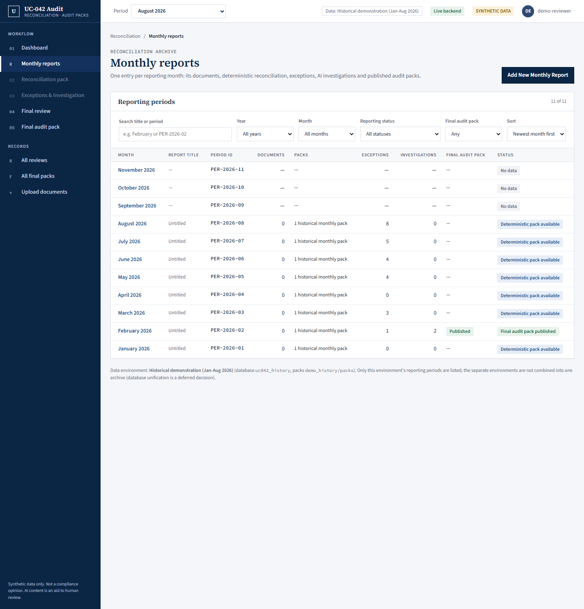
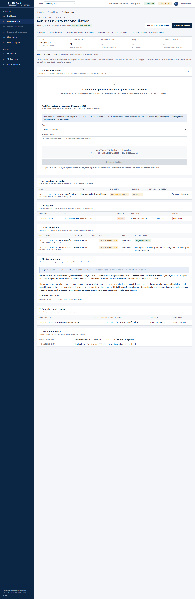
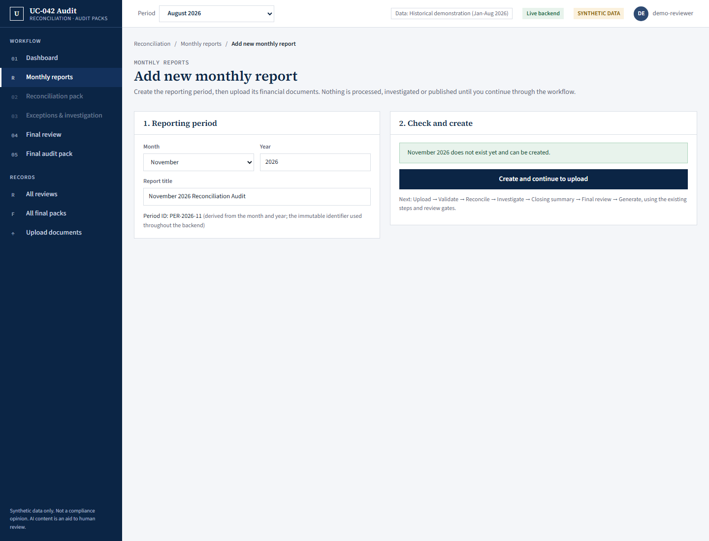
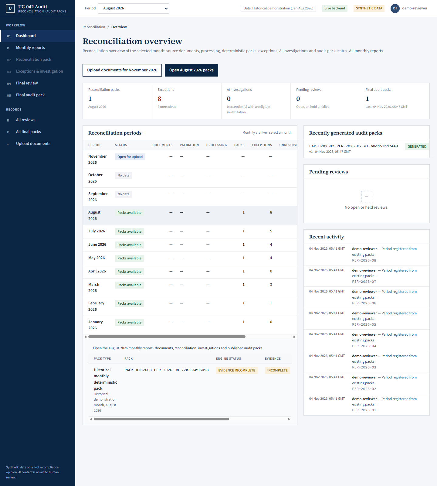
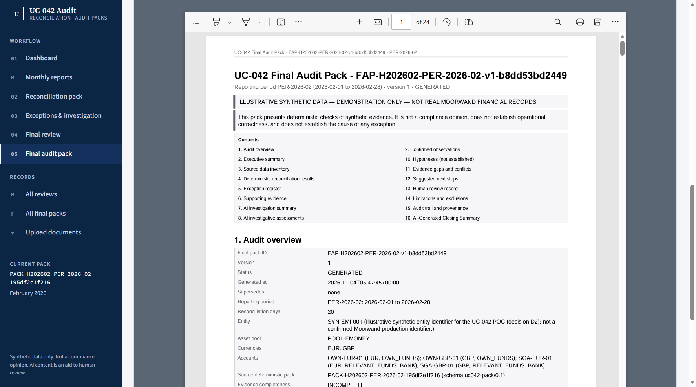

# 18 — Monthly Reports and Document Management: Implementation Report (Phase 7)

ILLUSTRATIVE SYNTHETIC DATA — DEMONSTRATION ONLY — NOT REAL MOORWAND FINANCIAL RECORDS.

Date: 4 November 2026. Scope: Phase 7, "Period-Aware Monthly Audit Management and Document Management", Parts A–M.

Not done in this phase, as the brief required:

- no live AI call;
- no new investigation, closing summary or final pack;
- no database unification;
- no change to the zero-balance rule;
- no change to reconciliation calculations;
- no fake November data.

Every published artefact, pack and dataset is byte-identical to its state before the phase (§12).

---

## 1. Initial implementation inspected

| Area | State before Phase 7 |
|---|---|
| Frontend | React + TypeScript + Vite. It used a `DataSource` abstraction (`apiSource` for the live backend, `MockDataSource` for offline design work). The work context (`workContext.tsx`) defaulted to a hardcoded `DEFAULT_PERIOD` of September 2026. |
| Period display | The dashboard and topbar assumed September. The dashboard said September was the only month with data. Scenario packs (SC1…SC5D) appeared as if they were months. A historical February pack could appear under a September-labelled context. `PeriodPage` (`/periods/:id`) showed one period's archive record and nothing else. |
| Backend | FastAPI (`uc042app`). The monthly archive was `GET /periods` and `GET /periods/{id}`, with uploads, validation, confirmation and processing in `services/monthly.py`. Periods had no title. Uploaded documents had no notion of "additional evidence" or "correction". |
| Databases | `uc042` holds the operational September environment: 9 demonstration-scenario packs and an empty publication registry. `uc042_history` holds Jan–Aug 2026: 8 historical packs, 1 February final pack, and a registry with 1 entry. Both were at Alembic revision `0001_initial`. They are separate backend instances with separate packs/investigations/final-packs roots, selected by environment variables. |
| PDF preview | `FinalPackPage` embedded the PDF Blob in an `<iframe>`. The report of a blank frame was reproduced in headless Edge (§8). |
| Reports 15–17 | Read for the policy register, investigation roots, the February end-to-end run, and the `ZERO_PATTERN` false positive. |

## 2. September-specific assumptions removed

- **Shared selected-period context.** `workContext.tsx` was rewritten with no default period.
  - `periodId` is optional.
  - It is derived from the open pack (`periodFromPackId`) or final pack (`periodFromFinalPackId`) when the URL names one.
  - Changing month clears the pack context.
  - When nothing is selected, the topbar picks the newest month that has data.
- **The topbar shows the selected period** ("February 2026"). Choosing a month opens `/reports/PER-YYYY-MM`.
- **February is labelled February.** Period labels come from the period ID, never from a fixed month. The sidebar "Current pack" block shows the pack's own month.
- **Removed text.** "Only month with data" and similar September text are gone from the dashboard, upload page and decision placeholder.
  - A unit test scans the screen sources for forbidden phrases: `reports.test.tsx`, "contains no September-only assumptions".
- **Pack-type labels.** The backend derives a `pack_kind` for each pack (`services/packs.py: pack_kind`), from the pack's scenario metadata only:

  | `pack_kind` | Label |
  |---|---|
  | `HISTORICAL_MONTHLY` | Historical monthly deterministic pack |
  | `DEMONSTRATION_SCENARIO` | Demonstration scenario pack |
  | `UPLOADED_DOCUMENTS` | Deterministic pack from uploaded documents |

  Final packs are labelled "Final audit pack". The pack page states that a deterministic pack is not a final audit report.
- **September scenarios grouped under one month.** The 9 scenario packs appear under September 2026 with the notice "9 demonstration scenarios for September 2026 … test scenarios of the same month, not different months". The notice appears only when a month has more than one scenario.

## 3. Monthly Reports archive

Route `/reports`, sidebar item "Monthly reports" (screenshot 1).

- **One row per month** from `GET /periods`. Each row shows:
  - title;
  - period ID;
  - document count;
  - packs, with their type;
  - exceptions;
  - published investigations;
  - final pack;
  - reporting status.
- **The status is derived from records only** (`routers/monthly.py: _reporting_status`), checked in this order:

  | Status | Condition |
  |---|---|
  | Final audit pack published | a registered final pack exists for the period |
  | Additional evidence received | as above, plus a document was uploaded after the latest final pack |
  | Investigation available | packs exist and at least one has a published investigation |
  | Deterministic pack available | packs exist |
  | Validation required | documents exist and the latest batch awaits the reviewer's confirmation of its validation results (`VALIDATED`) |
  | Documents uploaded | documents exist; the latest batch is confirmed |
  | No data | nothing exists for the month |

  An empty month is never shown as a completed report. October and September 2026 in the history environment show "No data".
- **Filters:** year, month, status and final-pack (yes/no), plus free-text search over title and period ID. Filters are kept in URL parameters. The default sort is newest first.
- **Active data environment** is shown unobtrusively:
  - in the topbar tag ("Data: Historical demonstration (Jan-Aug 2026)");
  - in a note on the archive that says the list shows only the active backend's database.

  The label comes from `UC042_ENVIRONMENT_LABEL`, falling back to "Database \<name\>", and is reported by `GET /health` as `environment`.

## 4. Period details page

Route `/reports/:periodId`. The old `/periods/:id` redirects there. Screenshot 2 shows February 2026.

The page has eight sections, with an index at the top:

1. **Overview:**
   - title, period ID, reporting status and environment;
   - counts of documents, packs, exceptions and investigations;
   - latest final pack;
   - the "Change title" action.
2. **Source documents:** every uploaded document, with its classification, submission type, reason, replaced document, hash and uploader. This section also holds "Add supporting document".
3. **Reconciliation results:** each deterministic pack with its type, engine status and evidence status, linking to the pack page.
4. **Exceptions:** each pack's exceptions, with severity and status.
5. **AI investigations:** published and eligible investigations for each pack (read from the existing investigation roots). Nothing is run.
6. **Closing summary:** the reviewed closing summary from the final-review session, where one exists. This is February only, from Phase 6B.
7. **Published audit packs:** final packs, with version, status, generated time and JSON/HTML/PDF downloads.
8. **Document history:** the period's activity events, such as creation, retitling, uploads, confirmations and publications.

## 5. New monthly report creation workflow

Route `/reports/new`, opened with the "Add New Monthly Report" button (screenshot 3).

- **Inputs:** a month select and a year input. No year is hardcoded; the year defaults to the current year.
- **Title:** defaults to "\<Month YYYY\> Reconciliation Audit" and can be edited before creation (3–120 characters).
- **Period ID:** shown as derived and immutable: `PER-YYYY-MM`.
- **Checks before creation:**
  - **Duplicate:** an existing month is reported with a link to its report. `create_period` returns the existing period unchanged and never alters its title.
  - **Future months** are refused (`FUTURE_PERIOD`).
  - **Title validation.**
- **Renaming** after creation needs the explicit "Change title" action, which calls `PATCH /api/v1/periods/{id}`. The period ID is never changed. The rename is logged as `PERIOD_RETITLED` with the previous and new title.
- **"Create and continue to upload"** goes to the existing upload page (`/upload?period=…&new=1`). From there the unchanged workflow applies: validate, then confirm, then process, then investigate (only when authorised), then final review, then generate. Nothing runs automatically. In particular, no AI step runs.
- **Testing:** the flow was tested with disposable test databases and temporary roots only. No November (or other) period was created in `uc042` or `uc042_history`, and no fake data was produced.

## 6. Additional document upload and versioning workflow

"Add supporting document" appears in section 2 of a report, and "Submission type" appears on the upload page. The period is inherited from the workspace; the user is never asked for the month again.

| Field | Stored in `source_documents` |
|---|---|
| Original filename, classification, size, SHA-256, upload time, uploader | existing columns |
| Submission type: `INITIAL`, `ADDITIONAL_EVIDENCE` or `CORRECTION` | `submission_kind` (new) |
| Reason for adding (required for non-initial submissions) | `submission_reason` (new) |
| Replaced document (corrections only) | `replaces_document_id` (new) |

Rules, enforced in `services/monthly.py`:

- **Corrections:**
  - must be a single file;
  - must name a document of the same period;
  - become a new version; the replaced document remains stored, unchanged and visible.
- **Originals are immutable.** Files are stored by content hash, and no API changes or deletes a stored document.
- **Duplicate warning.** Uploading the same content again keeps the existing `DUPLICATE` warning.
- **New validation messages:**

  | Message | Meaning |
  |---|---|
  | `SUPPORTING_EVIDENCE` | a readable file that is not a recognised financial input, submitted as additional evidence. It replaces the `UNRECOGNISED` error for that case only; an unrecognised *initial* upload still errors. |
  | `REPLACES_DOCUMENT` | the document this correction replaces |
  | `REPLACEMENT_TYPE_DIFFERS` | the correction's type differs from the replaced document's type |
  | `RECEIVED_AFTER_PUBLICATION` | the period already has a published final pack |

- **No new path.** A new version goes through the same validate, confirm and process steps as any batch.

## 7. Published-pack immutability handling

- Uploading evidence after publication **never modifies** a deterministic pack, investigation, closing summary or final pack. Final packs remain registered, versioned and hash-verified, and no code path writes to them from the upload flow.
- The period shows **"Pending reassessment"** (status "Additional evidence received") together with:
  - the count of documents received after the latest final pack (`documents_after_publication`);
  - a notice that the published pack has not incorporated them.
- Reassessment is not automatic. It uses the existing process: confirm, process, review, then generate a new final-pack version that supersedes the old one. That needs human action, and authorisation where AI is involved.
- The backend test `test_additional_evidence_after_publication_is_pending_reassessment_and_changes_nothing` hashes the final-pack directory before and after the upload and asserts equality.

## 8. PDF preview investigation and fix

| Check | Result |
|---|---|
| Is the PDF valid? | Yes. The published `final_pack.pdf` (24 pages) opens in PDFium, and `verify_final_pack` reports no problems. |
| Is the PDF served byte-identical? | Yes. A test compares `GET /final-packs/{id}/files/pdf` with the file on disk, with `Content-Type: application/pdf`. |
| Where did the blank frame come from? | Headless Edge reports `navigator.pdfViewerEnabled = true` but paints the embedded viewer blank. |
| Headful Edge (normal browser, driven over the DevTools protocol) | The PDF renders inline: toolbar, "1 of 24", page content (screenshot 5). |

The fix is in `ReportViewer.tsx: PdfViewer`. The PDF itself is unchanged.

- **Typed Blob.** The response Blob is rewrapped as `application/pdf` before the object URL is made, so the embedded viewer is never given an untyped blob.
- **Unsupported browsers.** Where `navigator.pdfViewerEnabled === false`, the frame is not rendered. A notice appears instead ("This browser cannot display PDFs inside the page"), with links to open the PDF in a new tab and to download it.
- **Fallback links.** Below the inline frame there are always "Open the PDF in a new tab" and "Download PDF" links, so a blank frame never leaves the user stuck. This covers headless or embedded browsers that claim support but do not paint.
- **Downloads** keep the published filename and bytes.

## 9. Database changes and migrations

New Alembic revision `0002_title_submissions` (down-revision `0001_initial`; additive only):

| Table | Column | Type / default |
|---|---|---|
| `reconciliation_periods` | `title` | Text, server default `''` |
| `source_documents` | `submission_kind` | String(24), server default `'INITIAL'` |
| `source_documents` | `submission_reason` | Text, server default `''` |
| `source_documents` | `replaces_document_id` | String(40), nullable |

- **Downgrade** drops the four columns.
- **Backups** taken before upgrading (pg_dump custom format):
  - `db_backups/uc042_before_0002_20261104.dump`
  - `db_backups/uc042_history_before_0002_20261104.dump`

  `db_backups/` was added to `.gitignore`.
- **Applied** to `uc042`, `uc042_history` and the test database. Both live databases now report `current 0002_title_submissions, latest 0002_title_submissions`.
- **No existing row was rewritten.**
  - Historical and September periods keep an empty title; the UI displays a title derived from the month.
  - Existing documents default to `INITIAL`.

## 10. Frontend and backend changes

**Backend (`uc042app`)**

- `db/models.py`, `db/repositories.py`, `repositories/base.py`: the new columns; `ensure(..., title="")` sets the title on creation only.
- `db/migrations/versions/0002_title_submissions.py`: new.
- `services/monthly.py`:
  - `create_period(year, month, title)`, which returns an existing period unchanged and refuses future months;
  - `rename_period`;
  - submission validation, with the codes `REASON_REQUIRED`, `INVALID_SUBMISSION` and `INVALID_ID`;
  - the submission-related validation messages.
- `services/packs.py`: `pack_kind`, plus `scenario_name` and `pack_kind` in pack summaries.
- `api/routers/monthly.py`:
  - period views with `title`, `reporting_status`, published and eligible investigation counts, `latest_final_pack_at`, `documents_after_publication` and `pending_reassessment`;
  - `PATCH /periods/{id}`;
  - the upload endpoint accepts `submission_kind`, `reason` and `replaces_document_id`.
- `api/routers/system.py`, `config.py`: `UC042_ENVIRONMENT_LABEL`; `/health.environment`.
- `api/schemas.py`: `DataEnvironment`, `UpdatePeriodRequest`, and the extended `Period`, `PeriodPackRef`, `PackSummary` and `SourceDocument`.

**Frontend (`frontend/src`)**

- New `pages/ReportPages.tsx`: the archive, the new-report form, the period details page and the supporting-document form.
- `App.tsx`: routes `/reports`, `/reports/new` and `/reports/:periodId`; a `/periods/:id` redirect.
- `components/layout/workContext.tsx` and `AppShell.tsx`: the period context, the topbar period selector, the environment tag and the "Monthly reports" navigation item.
- `data/periods.ts`:
  - period derivation from pack and final-pack IDs;
  - pack-type, reporting-status and submission labels.
- `data/DataSource.ts`, `apiSource.ts`, `MockDataSource.ts`, `api/endpoints.ts`, `api/types.ts`:
  - `openPeriod(year, month, title)`, `renamePeriod` and `uploadDocuments(…, submission)`.
  - The TypeScript types match the Pydantic models. The contract check covers 37 interfaces.
- `pages/DashboardPage.tsx`, `PackDetailPage.tsx`, `UploadPage.tsx`, `FinalPackPages.tsx`, `ArchivePages.tsx`, `components/upload/documents.tsx`, `components/review/decision.tsx`: period-neutral text, pack-type labels and breadcrumbs through "Monthly reports".
- `components/review/ReportViewer.tsx`: the PDF fix (§8).
- `styles/components.css`: `.env-tag`, `.filters`, `.section-index` and `.form-grid`, built with existing design tokens only.
- **Design.** The "Variation A: Enterprise Audit Platform" design (navy sidebar, serif headings, tokens) is unchanged. No colours, fonts or layout primitives were added.

## 11. Tests and exact results

New tests:

- **`tests/test_monthly_reports.py`** — 8 backend tests, using disposable databases and temporary copies of the February pack and final pack:
  - `PeriodsAndStatuses`:
    - grouping by month, with pack type and status;
    - title validation, duplicate handling and explicit rename;
    - status after upload, and the environment label.
  - `SupportingDocuments`:
    - after publication, evidence makes the period pending reassessment and changes nothing published;
    - an unrecognised initial upload keeps its error;
    - a correction becomes a linked new version;
    - a duplicate is flagged.
  - `FinalPackDownloads`: preview and downloads are byte-identical to the published files.
- **`frontend/src/test/reports.test.tsx`** — 12 tests:
  - period derivation from pack and final-pack IDs;
  - the forbidden-phrase source scan;
  - the archive built from backend records, and its filters;
  - February with its pack type;
  - the period kept across navigation;
  - explicit retitling;
  - supporting evidence on the open month;
  - a correction linked to the document it replaces;
  - the pending-reassessment notice;
  - period-ID derivation and the duplicate check;
  - the PDF fallback.
- **`archive.test.tsx` and `screens.test.tsx`** were updated for the new routes and labels. These include "9 demonstration scenarios" grouped under one month, and "Backend required" for the new-report form in mock mode.

Results:

| Suite | Result |
|---|---|
| Python `python -m unittest` (full) | 576 tests run (568 existing + 8 new); 574 passed, 1 skipped (opt-in live AI test), 1 failure: `ProtectedArtefacts.test_backend_tests_leave_controlled_folders_unchanged`. That failure was not caused by the code: during the run I executed the `uc042` admin checks without root overrides, which created `uc042/app_state/instance.lock` (empty) at 12:16:57. After removing that folder the test was re-run and passed. |
| Frontend `vitest run` | 35 passed, 2 skipped (live-backend tests, opt-in) |
| Frontend `npm run build` (`tsc --noEmit` + Vite) | OK |
| `frontend/scripts/check_contract.py` | OK, 37 interfaces |

## 12. February, historical and September preservation checks

- **File-integrity baseline.** 1202 files were hashed before any Phase 7 change (`sha256sum`) and re-checked afterwards.
  - The only files that differ are the 31 source files listed in §10, plus `.gitignore`.
  - These trees are byte-identical: `UC042_JAN_AUG_HISTORICAL_DEMO/`, `demo_history/` (packs, datasets, investigations, final packs, verification), `packs/`, `investigations/`, `uc042_dataset/` and `uc042lib/`. That includes the policy register, the validators and `ZERO_PATTERN`.
  - The only new files are the new source, test, migration and report files.
- **`tools/verify_demo_history.py`** (independent verifier):
  - all 8 historical packs report `OK`;
  - expected and actual exception counts match for every month (Jan 0, Feb 1, Mar 3, Apr 0, May 4, Jun 4, Jul 5, Aug 8);
  - month-to-month continuity matches.
- **February final pack.** `verify_final_pack(FAP-H202602-PER-2026-02-v1-b8dd53bd2449)` reports no problems. In headful Edge the PDF renders (24 pages).
- **`uc042_history` admin checks:**
  - `verify-registry`: 1 entry, all verified;
  - `verify-pack-references`: 14 references, 0 problems.
- **`uc042` admin checks:**
  - `verify-pack-references`: 9 references (the September scenarios SC1…SC5D), 0 problems;
  - `verify-registry`: 0 entries.
- **No change to existing records.** No investigation, closing summary, review decision or final pack was created, and no period, document or registry row was created in `uc042` or `uc042_history`.

## 13. Current database separation and its user-visible limitation

**The decision.** Unification is deferred, as the brief required (Part I). `uc042` (operational September, 9 demonstration scenarios) and `uc042_history` (Jan–Aug 2026, with the February final pack) remain separate databases, served by separate backend instances with separate file roots. Phase 7 did none of the following:

- merge or copy rows;
- synchronise across databases;
- combine pack directories;
- change pack identifiers;
- rewrite a registry;
- add an aggregating service.

**What users see:**

- The Monthly Reports archive shows **only the periods of the active backend's database**.
  - In the history environment, September 2026 is listed as "No data", although the September scenarios exist in `uc042`.
  - In the operational environment, January–August show "No data".
- The environment is named in the topbar tag ("Data: …") and in a note on the archive, so users can tell which database they are looking at. The archive never claims to contain both.

**What must be decided before unification:**

1. **Identity.** Whether the 9 September demonstration scenarios and an operational September can coexist under one `PER-2026-09`. How scenario packs are marked as non-production within a single archive.
2. **Pack and registry namespaces.** One packs/investigations/final-packs root, or several roots per environment. How each publication registry, with its sequence numbers and hash chain, is merged without rewriting history. A likely answer is a new registry that references the old ones, rather than edits to them.
3. **Migration path.** A one-off import (copying rows with provenance), or a read-only federation over both databases. Rollback plan and backups.
4. **Investigation-root profiles.** The `september` and `historical-demo` profiles currently isolate AI roots and the verification exclusions. A unified backend needs per-period roots, without exposing `demo_history/verification/`.
5. **Labelling and retention.** How synthetic and demonstration data is labelled in one archive, and whether demonstration data should live in the production database at all.
6. **Ownership.** Who approves the merged registry, and which environment label remains the source of truth during transition.

## 14. Outstanding issues and recommendations

1. **Zero-balance safety rule (unchanged).** `ZERO_PATTERN` (`uc042lib/investigation/validation.py`) rejects text like "balance … of 0.00" when evidence is missing.
   - **The false positive.** In Phase 6B it rejected February attempt 1. That finding reported a 0.00 *difference* that the engine explicitly marks as not computed, which is not a substitution of zero for a missing balance.
   - **Effect.** One rejected attempt and one retry, at extra token cost. No incorrect output was published.
   - **Recommendation.** A separate rule review should define when a reported zero, explicitly described as unverified or not computed, is acceptable. The rule stays as it is until then.
2. **Historical periods have empty titles.** The UI shows a derived title, and records were not altered. A title can be set later with "Change title". That action is logged, and only the title changes.
3. **Investigation count for February.** Phase 6A left an artefact under the February investigations root that is not in the publication registry. The period view counts *published* investigations from the investigation roots, so February shows 2, of which 1 is registered. A later change could count registry entries only. This phase does not alter either artefact.
4. **Corrections are available only on the report page,** where the replaced document can be chosen. The general upload page offers Initial and Additional evidence only.
5. **Reassessment uses the existing workflow.** "Pending reassessment" is a status and a notice. There is no dedicated "start reassessment" action; the user processes the new batch and, if authorised, re-reviews and generates a new final-pack version.
6. **PDF preview in headless or embedded browsers** may still show a blank frame where the browser claims PDF support but does not paint it. The links below the frame cover that case.
7. **Upload button on the dashboard** targets the current calendar month (November 2026), not the selected month. That is intentional for new uploads, and per-month uploads are on each report page. Consider labelling it "Upload documents for the current month" if it confuses users.
8. **Operations note.** On Windows, stopping the shell that launched `pg_ctl start` can break the PostgreSQL postmaster. This happened once during verification: a worker died with 0xC0000142, then "could not reserve shared memory region".
   - A restart recovered it cleanly ("redo done", ready to accept connections), and all integrity checks were run after the restart.
   - **Recommendation.** Run the cluster as a Windows service, or start it from a shell that stays open.

## 15. Screenshots

All screenshots were taken from the history environment (`uc042_history`, label "Historical demonstration (Jan-Aug 2026)") with the live backend.

1. Monthly reports archive: 
2. February 2026 report workspace: 
3. Add new monthly report (form only; nothing was created): 
4. Dashboard with the selected period: 
5. Final audit pack, PDF inline in headful Microsoft Edge: 

The September grouping in the operational environment is covered by automated tests ("9 demonstration scenarios", one month). A September screenshot was not taken, to avoid starting the operational backend against `uc042` during this phase.

---

## Assessment

| Capability | Status |
|---|---|
| Shared selected-period context; topbar period; correct February labelling; no September-only text | **Fully implemented** |
| Pack-type labels (historical monthly, demonstration scenario, uploaded, final audit pack); September scenarios grouped under one month | **Fully implemented** |
| Monthly Reports archive (one row per month, record-derived status, filters, search, newest first, environment shown) | **Fully implemented** |
| Monthly report details page with the 8 sections | **Fully implemented** |
| Add New Monthly Report (derived immutable ID, duplicates, explicit retitle, no hardcoded year, existing workflow, no automatic AI) | **Fully implemented** |
| Add Supporting Document (inherited period, classification, hash, uploader, reason, additional evidence vs correction, immutable originals, duplicate warning) | **Fully implemented** |
| Published packs never modified; "Pending reassessment" after publication | **Fully implemented** (status and notice) |
| Reassessment itself | **Partially implemented:** it uses the existing manual process-review-generate workflow; there is no dedicated reassessment action |
| PDF preview | **Fully implemented** for real browsers (verified headful); fallback links for browsers that do not paint |
| Design preserved | **Fully implemented** |
| Database / backend unification | **Deferred**, by instruction (§13) |
| Zero-balance rule review | **Deferred**, by instruction; documented (§14.1) |
| AI investigations for other months; new closing summaries or final packs | **Deferred**, by instruction; not authorised |
